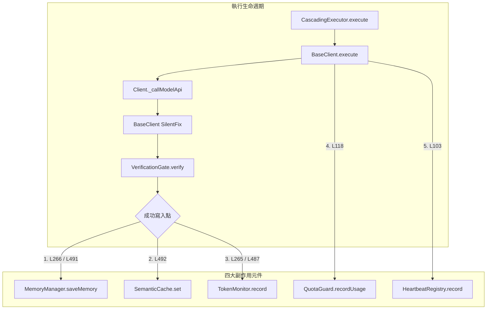

# P0-B Step 4.2-C — 級聯路由整合與容錯防線最終補充鑑識報告 (Final Design Clarification)

> **階段代號**：P0-B Step 4.2-C  
> **主題**：深入釐清探針生命週期、單調時鐘 Deadline、副作用寫入防線與 C-1～C-10 測試規格  
> **執行原則**：唯讀補充鑑識（Read-Only）、**零業務程式碼修改**、零架構膨脹、依真實程式碼行號取證  
> **作者/審計**：`etrnya`  

---

## 目錄
1. [問題一：Parallel Racing 探針生命週期與取消結算鏈](#1-問題一parallel-racing-探針生命週期與取消結算鏈)
2. [問題二：Global Task Deadline 與單調時鐘逾時控制](#2-問題二global-task-deadline-與單調時鐘逾時控制)
3. [問題三：副作用防線盤點 (Memory / Cache / Token / State)](#3-問題三副作用防線盤點-memory--cache--token--state)
4. [問題四：C-1 ～ C-10 確定性離線測試詳細規格](#4-問題四c-1--c-10-確定性離線測試詳細規格)
5. [最終修改檔案清單與責任邊界](#5-最終修改檔案清單與責任邊界)
6. [架構約束與邊界自我審查](#6-架構約束與邊界自我審查)

---

## 1. 問題一：Parallel Racing 探針生命週期與取消結算鏈

### 1.1 `canaryTokens` 實際傳遞格式與雙層 Token 結算路徑
經查驗現有程式碼：
- **准入端**：[`services/cascading_executor.js:207-212`](file:///c:/Users/etrny/.gemini/antigravity/scratch/model-hub-agent/services/cascading_executor.js#L207-L212)
  ```javascript
  const admission = heartbeatRegistry.canPass(capability.provider, capability.model_id);
  const canaryToken = admission.token || null;
  const canaryTokens = admission.tokens || null;
  // admission.tokens 格式: { providerToken: "probe_gen1_...", modelToken: "probe_gen1_..." }
  ```
- **客戶端注入**：[`infrastructure/clients/base_client.js:73-78`](file:///c:/Users/etrny/.gemini/antigravity/scratch/model-hub-agent/infrastructure/clients/base_client.js#L73-L78)
  `this.canaryToken` 與 `this.canaryTokens` 被存於 `BaseClient` 實例中。
- **結算端**：[`registry/heartbeat_registry.js:520-558`](file:///c:/Users/etrny/.gemini/antigravity/scratch/model-hub-agent/registry/heartbeat_registry.js#L520-L558)
  `record(target, latency, success, options)` 同時接收 `options.token` 與 `options.tokens`：
  - 成功時：若 Provider 為 `HALF-OPEN` 且持有有效 `providerToken`，呼叫 `provNode.recordSuccess()`；若 Model 持有有效 `modelToken`，呼叫 `modelNode.recordSuccess()`。
  - 失敗時：依 `faultScope` 分流結算（Provider 502 熔斷 Provider、Model 404 熔斷 Model 並中性釋放 Provider、`faultScope: 'NONE'` 則雙方中性釋放）。

### 1.2 `AbortError` 是否會進入 `BaseClient` 的一般錯誤 `record()` 流程？（重大發現）
**會！這正是原設計潛在重大缺陷的根因**。
- **呼叫鏈證據**：
  1. 底層觸發 `abort()` 時，`fetch` 會拋出 `name: 'AbortError'`。
  2. [`infrastructure/clients/base_client.js:135-140`](file:///c:/Users/etrny/.gemini/antigravity/scratch/model-hub-agent/infrastructure/clients/base_client.js#L135-L140) 捕獲該錯誤並傳入 `errorMapper.toHubError(rawError)`。
  3. [`infrastructure/adapters/error_mapper.js:251-258, 330`](file:///c:/Users/etrny/.gemini/antigravity/scratch/model-hub-agent/infrastructure/adapters/error_mapper.js#L251-L258)：
     ```javascript
     if (errName === 'AbortError' || errName === 'TimeoutError' ...) {
       type = this.ERROR_TYPES.TIMEOUT_ERROR; // 誤判為傳輸逾時
     }
     // L330:
     else if (type === this.ERROR_TYPES.TIMEOUT_ERROR) {
       faultScope = 'MODEL'; // 誤判為 MODEL 級故障！
     }
     ```
  4. [`infrastructure/clients/base_client.js:158-163`](file:///c:/Users/etrny/.gemini/antigravity/scratch/model-hub-agent/infrastructure/clients/base_client.js#L158-L163)：
     `BaseClient` 會以 `faultScope: 'MODEL'` 呼叫 `heartbeatRegistry.record()`，導致**落敗的模型被記一次失敗、甚至誤觸發重試迴圈**！

### 1.3 Executor 與 BaseClient 是否可能重複 Neutral Release？
**是的，若兩端各做一次就會發生重複呼叫**：
- 若 Executor 在 `Promise.any` 後主動對落敗者呼叫 `releaseProbe()`；
- 同時落敗者的非同步流程仍在運行，隨後拋出錯誤被 `BaseClient` 捕獲，`BaseClient` 又去呼叫一次 `record()`。
- **解決方案（單一職責原則）**：
  - **取消與結算統一在 `BaseClient` 的終端攔截**：
    在 `BaseClient.execute()` 的 `catch` 區塊，若檢測到是因取消引起的 `AbortError`（內部標記 `signal.aborted`）：
    1. 明確將其分類為內部取消（`faultScope = 'NONE'`，或直接終止不計入模型失敗）。
    2. 以 `{ faultScope: 'NONE', tokens: this.canaryTokens }` 呼叫 `heartbeatRegistry.record()`。
    3. `heartbeat_registry.js` 既有的 `faultScope === 'NONE'` 邏輯會**一次性且原子化地中性釋放**該請求持有的 `providerToken` 與 `modelToken`。
    4. `BaseClient` 不再進入後續的指數退避重試（`attempt < maxRetries` 直接中斷）。
    5. **Executor 端嚴禁額外手動呼叫 `releaseProbe()`**，徹底消滅重複結算的競爭條件！

### 1.4 `Promise.any` 勝出後，落敗請求的狀態與處置
- `Promise.any` 返回後，落敗者的 Promise 在 JavaScript 事件循環中仍然存活（In-Flight）。
- **處置原則**：
  1. **主動發出廣播中斷**：勝出者出爐時，Executor 呼叫落敗者的 `AbortController.abort('RACING_LOST')`。
  2. **在途狀態保護**：落敗請求尚未實際中斷前，其 Probe 依然受到健康狀態機的 `probeActive = true` 鎖定，其他外部請求不可搶佔，**嚴禁在請求尚未結束前提前釋放 Probe**。
  3. **終止即結算**：落敗請求收到中斷信號結束執行後，由其對應的 `BaseClient` 實例進行唯一結算（中性釋放）。

### 1.5 如何確保舊 Token 不會結算新一代 Probe？
- 依賴 `CircuitBreakerNode` 已凍結的世代校驗機制：
  在 [`registry/heartbeat_registry.js:184, 216, 256`](file:///c:/Users/etrny/.gemini/antigravity/scratch/model-hub-agent/registry/heartbeat_registry.js#L184)：
  ```javascript
  if (!token || token !== this.probeToken || this.activeGeneration !== this.generation) {
    return false; // 世代不吻合或 Token 不符，直接拒絕，完全無副作用
  }
  ```
- 即使落敗請求延遲了數十秒才返回，若該節點已因 Watchdog 到期進入新世代（`generation` 遞增），舊 Token 的任何回報將被無情拒絕，絕無可能污染新 Probe。

---

## 2. 問題二：Global Task Deadline 與單調時鐘逾時控制

### 2.1 單調時鐘可行性：Node.js 原生 `performance.now()`
- **環境驗證**：已於終端實體執行 `node -e "console.log(typeof performance.now === 'function')"`，回傳 `true`。
- **技術決策**：
  任務時間預算一律使用 `performance.now()` 計算時間差，杜絕系統時間校正 (NTP) 導致的 Wall Clock 突變。
  ```javascript
  const taskStartMonotonic = performance.now();
  const taskDeadlineMonotonic = taskStartMonotonic + taskTimeoutMs;
  // 計算剩餘時間：
  const remainingMs = Math.max(0, taskDeadlineMonotonic - performance.now());
  ```

### 2.2 Serial 與 Parallel 的實際執行路徑與 Deadline 共享
- **共享單一 Deadline**：
  在 `CascadingExecutor.execute(context, schema, options)` 最外層建立單一 `taskDeadlineMonotonic`。
- **Parallel Racing 階段**：
  - 競速整體共享該預算：
    ```javascript
    const raceRemaining = taskDeadlineMonotonic - performance.now();
    if (raceRemaining <= 0) throw new HubCascadingError("Task Timeout", { statusCode: 504 });
    ```
- **Serial Fallback 階段**：
  - 每個候選模型啟動前檢查：
    ```javascript
    const loopRemaining = taskDeadlineMonotonic - performance.now();
    if (loopRemaining <= 0) {
      throw new HubCascadingError("Global Task Timeout Exceeded", { statusCode: 504, type: 'HUB_TASK_TIMEOUT_EXCEEDED' });
    }
    ```

### 2.3 Provider Client 的取消能力與逾時傳遞現況
經逐一審查四大具體客戶端：
1. [`infrastructure/clients/gemini_client.js:91-95`](file:///c:/Users/etrny/.gemini/antigravity/scratch/model-hub-agent/infrastructure/clients/gemini_client.js#L91-L95)
2. [`infrastructure/clients/deepseek_client.js:45-58`](file:///c:/Users/etrny/.gemini/antigravity/scratch/model-hub-agent/infrastructure/clients/deepseek_client.js#L45-L58)
3. [`infrastructure/clients/nvidia_nim_client.js:63-75`](file:///c:/Users/etrny/.gemini/antigravity/scratch/model-hub-agent/infrastructure/clients/nvidia_nim_client.js#L63-L75)
4. [`infrastructure/clients/vertex_ai_client.js:93-105`](file:///c:/Users/etrny/.gemini/antigravity/scratch/model-hub-agent/infrastructure/clients/vertex_ai_client.js#L93-L105)

**程式碼現況**：
所有 Client 內部均直接呼叫 Node.js 全域 `fetch()`，且**目前皆未在 `fetch(url, options)` 中傳入 `signal`**！

### 2.4 「中止網路請求」vs「停止等待」的最小可行防護策略
在不大規模侵入各 Concrete Client 的前提下，採用雙層防禦架構：
1. **底層取消傳遞 (AbortSignal Propagation)**：
   在 `BaseClient.execute(state, schema, options)` 接收 `options.signal`，並傳入 `this._callModelApi(readyState, outputSchema, { signal: options.signal })`。
   在 Concrete Clients 的 `fetch` 選項中加入 `signal`。
2. **上層超時裁決門禁 (Timeout Gate / Stop-Waiting Fallback)**：
   若某自訂 Client 或 Mock 不支援 `signal`，`BaseClient` 以 `Promise.race()` 封裝：
   ```javascript
   const timeoutPromise = new Promise((_, reject) => {
     const timer = setTimeout(() => {
       const err = new Error("Client Execution Timeout");
       err.name = "TimeoutError";
       reject(err);
     }, clientTimeoutMs);
     if (typeof timer.unref === 'function') timer.unref();
   });
   ```
   **關鍵界線**：一旦逾時或被取消，主流程**立即停止等待並切換/終止**。即便底層 TCP 傳輸因未實作中止而稍後返回，該 Promise 的 Resolve 也會因主流程已 Reject 而被垃圾回收，絕不進入成功處理邏輯。

---

## 3. 問題三：副作用防線盤點 (Memory / Cache / Token / State)

### 3.1 寫入位置全域審計
經 Grep 與 AST 鑑識，系統各模組的寫入位置盤點如下：



| 副作用元件 | 寫入函式行號 | 呼叫位置說明 | 取消/逾時後是否可能被誤寫入？ |
| :--- | :--- | :--- | :---: |
| **`MemoryManager`** | [`cascading_executor.js:266`](file:///c:/Users/etrny/.gemini/antigravity/scratch/model-hub-agent/services/cascading_executor.js#L266)<br>[`cascading_executor.js:491`](file:///c:/Users/etrny/.gemini/antigravity/scratch/model-hub-agent/services/cascading_executor.js#L491) | 僅在 `CascadingExecutor` 任務完全成功且通過驗證後調用。 | ❌ 不會（集中於 Executor） |
| **`SemanticCache`** | [`cascading_executor.js:492`](file:///c:/Users/etrny/.gemini/antigravity/scratch/model-hub-agent/services/cascading_executor.js#L492) | 僅在 `CascadingExecutor` 串行迴圈成功通過驗證後調用。 | ❌ 不會（集中於 Executor） |
| **`TokenMonitor`** | [`cascading_executor.js:265`](file:///c:/Users/etrny/.gemini/antigravity/scratch/model-hub-agent/services/cascading_executor.js#L265)<br>[`cascading_executor.js:487`](file:///c:/Users/etrny/.gemini/antigravity/scratch/model-hub-agent/services/cascading_executor.js#L487) | 僅在 `CascadingExecutor` 成功後記錄。 | ❌ 不會（集中於 Executor） |
| **`QuotaGuard`** | [`base_client.js:118`](file:///c:/Users/etrny/.gemini/antigravity/scratch/model-hub-agent/infrastructure/clients/base_client.js#L118) | 在 `BaseClient.execute()` 成功解析驗證後調用。 | ⚠️ 若請求未被及時中止且延遲成功，可能誤寫入！ |
| **`HeartbeatRegistry`** | [`base_client.js:103, 148, 158`](file:///c:/Users/etrny/.gemini/antigravity/scratch/model-hub-agent/infrastructure/clients/base_client.js#L103) | 在 `BaseClient.execute()` 呼叫完成或拋錯時調用。 | ⚠️ 若被誤判為 MODEL 錯誤，可能污染狀態！ |
| **`GlobalState`** | [`shared/global_state.js`](file:///c:/Users/etrny/.gemini/antigravity/scratch/model-hub-agent/shared/global_state.js) | `CascadingExecutor` 內部僅讀取 `processedContext`，無原地狀態突變。 | ❌ 不會 |

### 3.2 真正需要增加防護的位置
1. **`services/cascading_executor.js`（入口與派發門禁）**：
   - 在 Parallel Racing 獲取勝出者後，在途落敗請求即使晚到完成，因 Executor 已返回，落敗請求的結果永遠不會觸及 `cascading_executor.js` L266 的 `saveMemory` 或 L492 的 `semanticCache.set`。
2. **`infrastructure/clients/base_client.js`（底層防護關鍵）**：
   - 在 [`base_client.js:100`](file:///c:/Users/etrny/.gemini/antigravity/scratch/model-hub-agent/infrastructure/clients/base_client.js#L100)（API 呼叫返回）與 L113（驗證完成）之間：
     **必須檢查 `if (this.signal && this.signal.aborted)`**！
     若已中止：
     - **不呼叫** `heartbeatRegistry.record(..., true)`（防止晚到成功解除熔斷器）。
     - **不呼叫** `quotaGuard.recordUsage()`（防止誤扣配額）。
     - 直接拋出 `AbortError`，交由 catch 區塊執行 `faultScope: 'NONE'` 的中性釋放。

---

## 4. 問題四：C-1 ～ C-10 確定性離線測試詳細規格

所有測試均置於 [`tests/test_router_cascading_integration.js`](file:///c:/Users/etrny/.gemini/antigravity/scratch/model-hub-agent/tests/test_router_cascading_integration.js)，使用 Virtual Clock，0 外部 API 依賴。

---

### Test C-1: 全模型 OPEN 時優雅 Fail-Closed (無 Null Pointer)
- **測試前置狀態**：透過 `heartbeatRegistry` 將所有註冊模型標記為 `OPEN`。
- **Mock 行為**：`router.getCandidates()` 觸發 Fallback 返回完整名單，但每個模型在 `canPass()` 均回傳 `allowed: false, reason: 'CIRCUIT_OPEN'`。
- **實際呼叫路徑**：`cascadingExecutor.execute(context, schema)`。
- **精確斷言**：
  - 拋出之例外為 `HubCascadingError`。
  - `error.statusCode === 503`。
  - `error.type === 'HUB_ALL_CANDIDATES_CIRCUIT_OPEN'`。
  - `error.attempts === 0`。
  - **嚴格斷言絕不拋出 `TypeError: Cannot read properties of null`**。
- **可能失敗的代碼位置**：[`cascading_executor.js:525`](file:///c:/Users/etrny/.gemini/antigravity/scratch/model-hub-agent/services/cascading_executor.js#L525) 的 `lastError.message`。

---

### Test C-2: 最小 Retry-After 精確計算 (排除永久故障與未參與節點)
- **測試前置狀態**：
  - 候選模型 A：`notBefore = now + 15000` (剩餘 15s)。
  - 候選模型 B：`notBefore = now + 40000` (剩餘 40s)。
  - 候選模型 C：`permanent: true` (永久 OPEN)。
  - 未參與本次路由的模型 D：`notBefore = now + 2000` (剩餘 2s，不支援本次模態)。
- **Mock 行為**：執行 `cascadingExecutor.execute()`。
- **實際呼叫路徑**：`CascadingExecutor` 收集被拒候選模型的 `retryAfterMs`。
- **精確斷言**：
  - `error.retryAfterMs === 15000`（精準取 A 與 B 之最小值，排除永久 C 與無關 D）。
- **可能失敗的代碼位置**：收集邏輯若誤取了全域 `heartbeatRegistry.nodes`，會錯誤取到無關節點 D。

---

### Test C-3: Router 與 QuotaGuard 契約一致性 (純查詢無扣額)
- **測試前置狀態**：Provider `deepseek` 的 RPM 限制為 5，`quotaGuard` 累計計數設為 5。
- **Mock 行為**：比對 `router.route()` 與 `router.getCandidates()`。
- **實際呼叫路徑**：連續呼叫 `router.getCandidates()` 3 次。
- **精確斷言**：
  - 兩方法回傳之候選清單中，均不包含 `deepseek`。
  - `quotaGuard.usage.get('deepseek').requests` 仍然精確等於 5，**確認無重複扣額或預算突變**。
- **可能失敗的代碼位置**：[`router.js:114-122`](file:///c:/Users/etrny/.gemini/antigravity/scratch/model-hub-agent/services/router.js#L114-L122) 遺漏 `quotaGuard` 檢查。

---

### Test C-4: 全域 Task Deadline 阻止後續模型啟動 (含真正執行逾時)
- **測試前置狀態**：設定 `options.taskTimeoutMs = 100`。
- **Mock 行為**：
  - Model 1 執行延遲 120ms 拋出超時錯誤。
  - Model 2 設為正常回應。
- **實際呼叫路徑**：`cascadingExecutor.execute(context, schema, { taskTimeoutMs: 100 })`。
- **精確斷言**：
  - Model 1 失敗後，Executor 檢測到單調時間已超過 Deadline。
  - **Model 2 絕未被調用**（調用次數為 0）。
  - 終端拋出 504 `HUB_TASK_TIMEOUT_EXCEEDED`。
- **可能失敗的代碼位置**：[`cascading_executor.js:281`](file:///c:/Users/etrny/.gemini/antigravity/scratch/model-hub-agent/services/cascading_executor.js#L281) 迴圈起始處缺少 Deadline 到期檢查。

---

### Test C-5: Client 執行時間受剩餘預算動態壓縮
- **測試前置狀態**：任務預算總共 5000ms。前置準備耗時模擬 2000ms。
- **Mock 行為**：Mock Client 記錄其收到的 `executionOptions.timeoutMs`。
- **實際呼叫路徑**：`cascadingExecutor.execute()` -> `client.execute()`。
- **精確斷言**：
  - 該模型宣告之預設逾時為 30000ms。
  - 實例接收到的 `timeoutMs` 被精確壓縮為約 `3000ms`（$\le 3000$ 且 $> 2800$）。
- **可能失敗的代碼位置**：[`cascading_executor.js:298-316`](file:///c:/Users/etrny/.gemini/antigravity/scratch/model-hub-agent/services/cascading_executor.js#L298-L316) 傳入 Client 時固定寫死預設值。

---

### Test C-6: Parallel Racing 勝出後落敗者雙層探針完整中性釋放
- **測試前置狀態**：
  - Provider P2 處於 `HALF-OPEN`。
  - Model A 與 Model B 同時處於 `HALF-OPEN`，各自簽發獨立雙層 Token。
- **Mock 行為**：
  - Model A 50ms 成功返回。
  - Model B 執行耗時 300ms（模擬網絡延遲）。
- **實際呼叫路徑**：啟動 `isRacing: true`，`Promise.any` 接收 A 的結果。
- **精確斷言**：
  - Model A 正常復原為 `CLOSED`。
  - Model B 接收到中斷訊號後，其 Token 被中性釋放：`nodeB.state === 'HALF-OPEN'`，`nodeB.probeActive === false`，`nodeB.consecutiveFailures` 未增加。
  - 下一個請求呼叫 Model B 可以立即再次准入。
- **可能失敗的代碼位置**：競速結束未對落敗者發出 Abort，造成落敗者懸掛 15 秒。

---

### Test C-7: 競速落敗者晚到回應不污染狀態、快取與 TokenMonitor
- **測試前置狀態**：同 C-6，但 Model B 延遲至 100ms 假裝成功返回。
- **Mock 行為**：驗證 `memoryManager.saveMemory`、`semanticCache.set` 與 `tokenMonitor.record` 的調用參數與次數。
- **實際呼叫路徑**：A 勝出後返回調用方，等待 B 的延遲 Promise 沉澱。
- **精確斷言**：
  - `memoryManager.saveMemory` 僅被呼叫 1 次（Payload 包含 A 的標記，絕不含 B）。
  - `tokenMonitor.totalTokens` 僅累加 A 之消耗，B 的晚到消耗被阻擋。
  - `heartbeatRegistry.getNode('p:model-B')` 絕未被標記為 `CLOSED`（不發生幽靈成功解除）。
- **可能失敗的代碼位置**：`BaseClient` 在 `_callModelApi` 返回後缺少 `signal.aborted` 檢查，逕自呼叫 `recordSuccess`。

---

### Test C-8: 終端 HubError 完整保留級聯摘要與多層失敗軌跡
- **測試前置狀態**：配置 3 個候選模型。
- **Mock 行為**：
  - Model 1 失敗回傳 401 (`HUB_AUTH_ERROR`)。
  - Model 2 失敗回傳 500 (`HUB_PROVIDER_SERVER_ERROR`)。
  - Model 3 失敗回傳 429 (`HUB_RATE_LIMIT`)。
- **實際呼叫路徑**：遍歷所有候選直至終端拋錯。
- **精確斷言**：
  - 終端錯誤為 `HubCascadingError`。
  - `error.statusCode === 502`（混合失敗仲裁為 502）。
  - `error.cascadingSummary` 長度為 3。
  - `error.cascadingSummary[0].statusCode === 401`。
  - `error.cascadingSummary[1].statusCode === 500`。
  - `error.cascadingSummary[2].statusCode === 429`。
- **可能失敗的代碼位置**：[`cascading_executor.js:525`](file:///c:/Users/etrny/.gemini/antigravity/scratch/model-hub-agent/services/cascading_executor.js#L525) 直接拋出 `new Error(lastError.message)`。

---

### Test C-9: Abort 與 BaseClient 錯誤回報競爭 (驗證無雙重 Probe 結算)
- **測試前置狀態**：Model 處於 `HALF-OPEN`，獲取 `probe_gen1_xxx`。
- **Mock 行為**：在 Client 內部請求發出瞬間觸發 `abort()`。
- **實際呼叫路徑**：底層拋出 `AbortError` -> 進入 `BaseClient.catch`。
- **精確斷言**：
  - `BaseClient` 識別為內部取消，呼叫 `record(..., { faultScope: 'NONE' })`。
  - 節點僅執行 1 次 `releaseProbe()`。
  - 驗證節點 `generation` 依然為 1，`probeActive === false`，`state === 'HALF-OPEN'`。
  - 外層 Executor 捕獲到 Abort 後，**不再呼叫第二次結算**。
- **可能失敗的代碼位置**：`error_mapper.js` 將 `AbortError` 誤判為 `TIMEOUT_ERROR`，導致觸發 `recordFailure`。

---

### Test C-10: 單調時鐘與 Parallel Deadline (防範 Wall Clock 突變)
- **測試前置狀態**：啟動並行競速，任務預算 2000ms。
- **Mock 行為**：
  - 注入模擬 `Date.now`，在請求執行期間手動將 `Date.now()` 往前撥慢 1 小時（模擬 NTP 伺服器校時或日光節約時間調整）。
  - 系統內部的 `performance.now()` 單調遞增。
- **實際呼叫路徑**：`cascadingExecutor.execute(context, schema, { race: true, taskTimeoutMs: 2000 })`。
- **精確斷言**：
  - 任務超時判斷完全基於 `performance.now()` 的單調增量。
  - 任務在經過實際 2000ms 後正常觸發超時中斷，**絕不因 `Date.now()` 變小而導致逾時判定失效或死循環**。
- **可能失敗的代碼位置**：代碼中使用 `Date.now() - startTime` 判定時間預算。

---

## 5. 最終修改檔案清單與責任邊界

依據補充鑑識結果，確定最小且完整的修改檔案如下：

| 修改檔案 | 職責邊界與修改內容 |
| :--- | :--- |
| [`services/router.js`](file:///c:/Users/etrny/.gemini/antigravity/scratch/model-hub-agent/services/router.js) | 抽取 `_isEligibleCandidate()`，使 `getCandidates()` 與 `route()` 共享無副作用配額與健康過濾。 |
| [`infrastructure/adapters/error_mapper.js`](file:///c:/Users/etrny/.gemini/antigravity/scratch/model-hub-agent/infrastructure/adapters/error_mapper.js) | 修正 `AbortError` 分類：若為內部取消信號，將其 `faultScope` 設為 `'NONE'`，不誤判為 MODEL 級超時。 |
| [`infrastructure/clients/base_client.js`](file:///c:/Users/etrny/.gemini/antigravity/scratch/model-hub-agent/infrastructure/clients/base_client.js) | 1. 支援 `signal` 傳遞與逾時檢查。<br>2. API 返回後檢查 `signal.aborted`，阻斷晚到成果觸發 `recordUsage` 與 `recordSuccess`。<br>3. 捕獲 `AbortError` 時以 `faultScope: 'NONE'` 結算，並終止原地重試。 |
| [`services/cascading_executor.js`](file:///c:/Users/etrny/.gemini/antigravity/scratch/model-hub-agent/services/cascading_executor.js) | 1. 建立 `performance.now()` 單調 Deadline 門禁。<br>2. 實作全模型 OPEN、全 Quota 耗盡的結構化 Fail-Closed。<br>3. 競速落敗者廣播 `AbortController.abort()`。<br>4. 終端封裝拋出 `HubCascadingError`。 |
| [`tests/test_router_cascading_integration.js`](file:///c:/Users/etrny/.gemini/antigravity/scratch/model-hub-agent/tests/test_router_cascading_integration.js) | 新增 C-1 ～ C-10 專屬確定性跨模組測試。 |

---

## 6. 架構約束與邊界自我審查

| 檢驗原則 | 遵循情況 | 審查說明 |
| :--- | :---: | :--- |
| **1. 不重構狀態機** | ✅ 遵循 | `heartbeat_registry.js` 完全凍結，僅透過其對外 API (`canPass`, `record`, `isCandidateEligible`) 互動。 |
| **2. 不新增 Manager** | ✅ 遵循 | 邏輯收斂於現有 `router`、`cascading_executor`、`base_client`、`error_mapper`，無新增抽象層。 |
| **3. 不碰 GlobalState** | ✅ 遵循 | `shared/global_state.js` 零修改。 |
| **4. 零外部 API 依賴** | ✅ 遵循 | C-1 ～ C-10 全部使用 Mock Client 與 Virtual Clock，確保 `npm test` 100% 離線確定性。 |
| **5. 唯讀補充鑑識先行** | ✅ 遵循 | 本次動作僅產生本補充鑑識文檔，**零業務代碼修改**，停止等待審查裁決。 |

---

> [!IMPORTANT]
> **執行停止聲明**：  
> 本補充鑑識報告已詳盡回答探針生命週期、單調時鐘、副作用防禦與 C-1 ～ C-10 測試規格。  
> 依循紀律，**在此立即停止作業，等待架構審查核准，絕不逕自開始修改業務代碼**。
