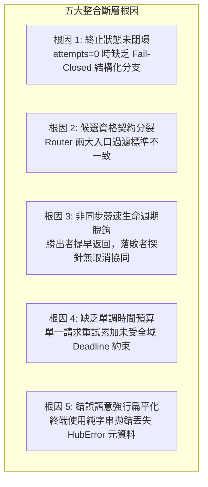
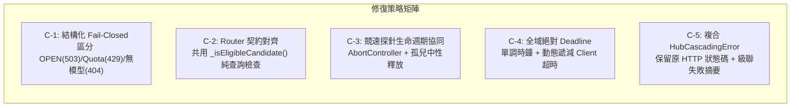
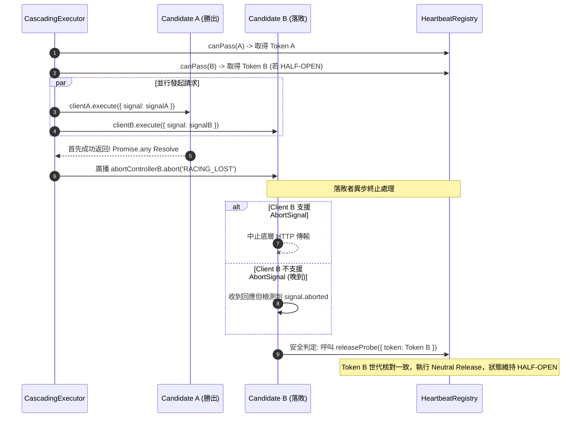
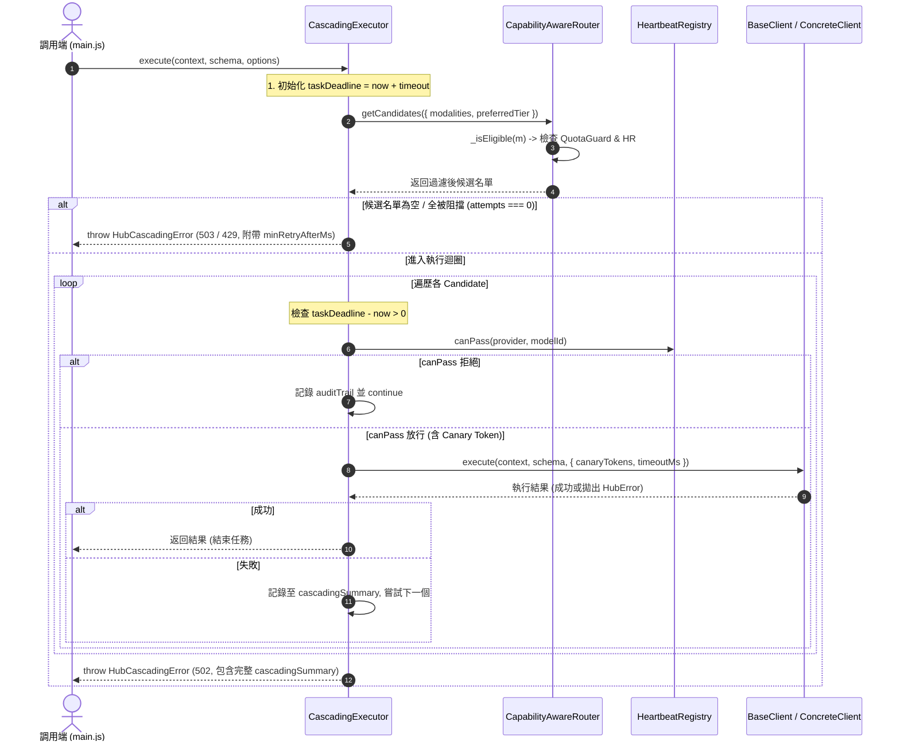

# P0-B Step 4.2-C — 級聯路由整合與容錯防線修訂版實作計畫 (Implementation Plan)

> **計畫代號**：P0-B Step 4.2-C  
> **主題**：級聯路由整合、Fail-Closed、配額契約一致性、並行競速探針生命週期、全域時間預算與結構化錯誤保全  
> **審查狀態**：修訂版規劃中，等待架構裁決（**本階段零程式碼修改**）  
> **作者/審計**：`etrnya`  

---

## 目錄
1. [現況程式碼證據與檔案位置盤點](#1-現況程式碼證據與檔案位置盤點)
2. [五大核心問題根因分析](#2-五大核心問題根因分析)
3. [五大修復策略與架構技術決策](#3-五大修復策略與架構技術決策)
4. [核心技術問題深度剖析 (A ~ E)](#4-核心技術問題深度剖析-a--e)
5. [修改檔案清單與範圍限制](#5-修改檔案清單與範圍限制)
6. [模組介面定義與資料流 (Data Flow)](#6-模組介面定義與資料流-data-flow)
7. [競爭條件與異常邊界分析 (Race Conditions & Edge Cases)](#7-競爭條件與異常邊界分析-race-conditions--edge-cases)
8. [C-1 ～ C-8 確定性離線測試規格 (Deterministic Test Suite)](#8-c-1--c-8-確定性離線測試規格-deterministic-test-suite)
9. [向下相容性與系統風險評估](#9-向下相容性與系統風險評估)
10. [明確排除項目 (Out of Scope)](#10-明確排除項目-out-of-scope)

---

## 1. 現況程式碼證據與檔案位置盤點

| 模組名稱 | 檔案位置 | 關鍵行號 | 現況邏輯與問題特徵 |
| :--- | :--- | :--- | :--- |
| **CascadingExecutor** | [`services/cascading_executor.js`](file:///c:/Users/etrny/.gemini/antigravity/scratch/model-hub-agent/services/cascading_executor.js) | L285-L289<br>L525 | 候選全數因 `!admission.allowed` 被跳過時，`attempts === 0` 且 `lastError === null`，執行 `lastError.message` 引發 `TypeError: Cannot read properties of null`。 |
| **CapabilityAwareRouter** | [`services/router.js`](file:///c:/Users/etrny/.gemini/antigravity/scratch/model-hub-agent/services/router.js) | L66-L72<br>L114-L122 | `route()` 同時檢查 `quotaGuard.canProceed` 與 `isCandidateEligible`；但實際驅動調度的 `getCandidates()` 僅檢查健康狀態，**完全遺漏了配額檢查**。 |
| **Parallel Racing** | [`services/cascading_executor.js`](file:///c:/Users/etrny/.gemini/antigravity/scratch/model-hub-agent/services/cascading_executor.js) | L205-L278 | `Promise.any` 僅等待勝出者，落敗者的在途 Promise 成為孤兒，其所持有的 Canary Token 缺乏協同取消與中性釋放，引發探針懸掛風險。 |
| **Task Budget Control** | [`services/cascading_executor.js`](file:///c:/Users/etrny/.gemini/antigravity/scratch/model-hub-agent/services/cascading_executor.js) | L193-L195<br>L339-L347 | 具備 Token 預算與美元費用熔斷，但**缺乏單一任務絕對時間預算 (Global Task Deadline)**，7 個候選模型重試累加可阻塞超過 1~2 分鐘。 |
| **Error Propagation** | [`services/cascading_executor.js`](file:///c:/Users/etrny/.gemini/antigravity/scratch/model-hub-agent/services/cascading_executor.js) | L525 | 終端拋出普通字串 `new Error(...)`，抹除了 `HubError` 的 `type`、`statusCode`、`faultScope` 與各候選模型之失敗軌跡。 |

---

## 2. 五大核心問題根因分析



1. **終止狀態未閉環**：級聯執行器預設「至少會有 1 次實際執行嘗試」。當所有候選模型因 Circuit OPEN、Quota 耗盡而在 Admission Gate 被攔截時，執行器缺少對「0 次實際呼叫」的情境判定，導致 `lastError` 維持 `null`。
2. **候選資格契約分裂**：歷史重構過程中，`route()` 與 `getCandidates()` 由不同階段實作，`quotaGuard` 檢查未抽成共用契約，導致 Executor 遍歷已被 Quota 封鎖的無效節點。
3. **競速探針生命週期脫鉤**：`Promise.any()` 原生機制在首個 Promise Resolve 後即結束等待，但其餘 Promise 仍在事件循環中排程。落敗者的 Canary Token 若未被顯式中止，將處於在途狀態直至逾時。
4. **缺乏單調時間預算**：現有逾時檢查分散於各 Client 原地重試，缺乏任務層級的絕對截止時間戳記，無法動態壓縮後續候選嘗試的可用耗時。
5. **錯誤語意強行扁平化**：將結構化的 `HubError` 轉字串丟出，使得外層 Web API 與調用端無法根據 HTTP 狀態碼（如 503 vs 429）做出合適的客戶端退避。

---

## 3. 五大修復策略與架構技術決策



| 項目 | 策略原則 | 具體做法 |
| :---: | :--- | :--- |
| **C-1** | 精確故障分類 Fail-Closed | 迴圈結束若 `attempts === 0`，檢查各模型之排除原因；全 OPEN 則提取有效最小 `retryAfterMs` 拋出 503；全 Quota 拋出 429；完全杜絕 Null Pointer。 |
| **C-2** | 零副作用共用契約 | 建立 `_isEligibleCandidate(m)` 私有輔助函式，整合 `quotaGuard.canProceed` 與 `heartbeatRegistry.isCandidateEligible`，雙入口統一調用，不重複扣額度。 |
| **C-3** | 競速孤兒安全結算 | 引入 `AbortController` 協同廣播，勝出者確立後主動 abort 落敗者；落敗者異步終止時，若持有效 Token 則強制呼叫 `releaseProbe()` 執行 Neutral Release。 |
| **C-4** | 絕對截止時間戳記 (Deadline) | 任務起始計算 `taskDeadline = Date.now() + budget`；每次嘗試之 `timeoutMs = Math.min(clientDefault, taskDeadline - Date.now())`；剩餘時間 $\le 0$ 時立即中斷。 |
| **C-5** | 複合級聯錯誤實體 | 封裝繼承自 `HubError` 的 `HubCascadingError`，附帶 `cascadingSummary` 陣列記錄各模型狀態，對外維持標準 HTTP Status 與 `message` 相容性。 |

---

## 4. 核心技術問題深度剖析 (A ~ E)

### A. Fail-Closed 終止狀態與最小 Retry-After 計算

#### 1. 失敗情境精確四分流
在 `CascadingExecutor` 執行前與遍歷過程中，建立明確的計數器：
```javascript
const auditTrail = {
  totalCandidates: candidates.length,
  blockedByCircuitOpen: 0,
  blockedByQuota: 0,
  executionAttempts: 0,
  rejectionDetails: [] // { modelId, provider, reason, retryAfterMs }
};
```
- **情境 1：無任何符合能力的模型 (404)**  
  `candidates.length === 0` 且未經過濾前即為空：拋出 `HUB_MODEL_NOT_FOUND` (HTTP 404)。
- **情境 2：所有候選模型均因 Circuit OPEN 被拒 (503)**  
  `auditTrail.executionAttempts === 0` 且 `auditTrail.blockedByCircuitOpen === candidates.length`：  
  拋出 `HUB_ALL_CANDIDATES_CIRCUIT_OPEN` (HTTP 503)。
- **情境 3：所有候選模型均因 Quota 耗盡被拒 (429)**  
  `auditTrail.executionAttempts === 0` 且 `auditTrail.blockedByQuota === candidates.length`：  
  拋出 `HUB_QUOTA_EXCEEDED` (HTTP 429)。
- **情境 4：實際執行後全部失敗 (502 / Compound)**  
  `auditTrail.executionAttempts > 0`：拋出 `HUB_CASCADING_FAILED` (HTTP 502)，並攜帶最後或最高優先級之錯誤。

#### 2. 最小 `retryAfterMs` 的精準過濾計算
- **規則**：僅計算**在本次任務中實際造成拒絕、且處於臨時 OPEN 狀態的節點**。
- **演算法**：
  ```javascript
  const validRetries = auditTrail.rejectionDetails
    .filter(d => d.reason === 'CIRCUIT_OPEN' && typeof d.retryAfterMs === 'number' && d.retryAfterMs > 0)
    .map(d => d.retryAfterMs);
  
  const minRetryAfterMs = validRetries.length > 0 ? Math.min(...validRetries) : null;
  ```
- **防禦**：排除未參與本次路由的無關節點；排除 `PERMANENT_OPEN`（永久故障其 retryAfter 為 null 或無效）。

---

### B. QuotaGuard 契約對齊與零副作用保證

#### 1. `canProceed()` 屬性確認
經查驗 [`infrastructure/adapters/quota_guard.js:16-32`](file:///c:/Users/etrny/.gemini/antigravity/scratch/model-hub-agent/infrastructure/adapters/quota_guard.js#L16-L32)：
- `canProceed(provider, limits)` 僅比對 `stats.requests >= limits.rpm`。
- 內部僅在時間超過 60 秒時做被動重置 (`_resetWindow`)，**不增加任何計數**。
- 實際計數僅在 [`BaseClient.execute():118`](file:///c:/Users/etrny/.gemini/antigravity/scratch/model-hub-agent/infrastructure/clients/base_client.js#L118) 成功執行後由 `recordUsage()` 累加。
- **結論**：`canProceed()` 具備等冪性（Idempotent），純查詢無扣額副作用。

#### 2. 共用候選過濾輔助函式
在 `services/router.js` 內部新增私有方法：
```javascript
_isEligible(m, heartbeatRegistry) {
  const quotaOk = quotaGuard.canProceed(m.provider, m.limits);
  const healthOk = typeof heartbeatRegistry.isCandidateEligible === 'function'
    ? heartbeatRegistry.isCandidateEligible(m.provider, m.model_id)
    : heartbeatRegistry.isHealthy(m.provider, m.model_id);
  return quotaOk && healthOk;
}
```
`route()` 與 `getCandidates()` 統一呼叫 `this._isEligible(m, heartbeatRegistry)`，達成 100% 契約一致，無架構膨脹。

---

### C. Parallel Racing（並行競速）探針生命週期與協同取消

#### 1. 競速取消時序與生命週期狀態機


#### 2. 防範落敗請求晚到的三大隔離措施
1. **成果捨棄**：落敗請求完成時，若 `signal.aborted === true`，嚴禁調用 `memoryManager.saveMemory`、`semanticCache.set` 與 `tokenMonitor.record`。
2. **探針中性釋放**：落敗請求若曾持有 `canaryToken`，在捕獲到 `AbortError` 或請求完成但已被宣告落敗時，**一律呼叫 `provNode.releaseProbe({ token })`**，絕不呼叫 `recordSuccess` 或 `recordFailure`。
3. **世代保護**：依賴已實作的 `activeGeneration === this.generation`。若落敗者的回應極度延遲（超過 Watchdog 到期），其過期 Token 在 `releaseProbe` 與 `record` 中均會被直接忽略，絕不污染新一代狀態。

---

### D. Global Task Deadline 與單調時鐘超時控制

#### 1. 絕對截止時間計算模型
- **任務啟動基準**：
  ```javascript
  const taskTimeoutMs = options.taskTimeoutMs || parseInt(process.env.MAX_TASK_TIMEOUT_MS || '45000', 10);
  const taskStartTime = Date.now();
  const taskDeadline = taskStartTime + taskTimeoutMs;
  ```
- **單調防護**：每次候選模型執行前，動態計算剩餘時間：
  ```javascript
  const remainingMs = taskDeadline - Date.now();
  if (remainingMs <= 0) {
    throw errorMapper.createError('global', {
      status: 504,
      message: `[CascadingExecutor] Global task timeout of ${taskTimeoutMs}ms exceeded before starting ${capability.model_id}.`,
      type: 'HUB_TASK_TIMEOUT_EXCEEDED'
    });
  }
  ```
- **注入 Client 超時上限**：
  傳入 `executionOptions`：
  ```javascript
  const clientTimeoutMs = Math.min(capability.timeout_ms || 30000, remainingMs);
  const executionOptions = {
    timeoutMs: clientTimeoutMs,
    canaryToken,
    canaryTokens,
    taskDeadline
  };
  ```

#### 2. Client 取消能力矩陣與晚到防護
| Client 類型 | 底層通訊機制 | 是否支援 AbortSignal 取消 | 晚到回應防禦策略 |
| :--- | :--- | :---: | :--- |
| **Gemini Client** | Google GenAI SDK / Fetch | ✅ 支援 | 傳遞 `signal`，原生中止傳輸，捕獲 `AbortError` 快速退出。 |
| **DeepSeek Client** | OpenAI SDK / Fetch | ✅ 支援 | 傳遞 `signal`，中止請求。 |
| **Nvidia NIM Client** | Fetch HTTP API | ✅ 支援 | 原生傳遞 `signal`。 |
| **Vertex AI Client** | Google Auth + Fetch | ✅ 支援 | 原生傳遞 `signal`。 |
| **Mock / Custom** | 測試樁 | ⚠️ 部分支援 | 外層以 `Promise.race([clientPromise, timeoutPromise])` 封裝，逾時即 Resolve/Reject，不等待底層。 |

---

### E. HubError 語意保留與級聯失敗摘要

#### 1. `HubCascadingError` 資料結構
為保留結構化錯誤並提供完整的除錯視圖，擴充封裝：
```javascript
class HubCascadingError extends Error {
  constructor(message, options = {}) {
    super(message);
    this.name = 'HubCascadingError';
    this.type = options.type || 'HUB_CASCADING_FAILED';
    this.statusCode = options.statusCode || 502;
    this.faultScope = options.faultScope || 'TASK';
    this.retryAfterMs = options.retryAfterMs || null;
    this.attempts = options.attempts || 0;
    this.cascadingSummary = options.cascadingSummary || []; // 歷次候選結果清單
    this.cause = options.cause || null;
  }
}
```

#### 2. 多模型混合失敗時的 HTTP 狀態碼仲裁表
當經歷多個模型重試並全部失敗時，依以下優先級決定終端 `statusCode` 與 `type`：

| 優先級 | 失敗特徵 | 終端 statusCode | 終端 type | 裁決理由 |
| :---: | :--- | :---: | :--- | :--- |
| **1** | 任務達到全域時間預算 | **504** | `HUB_TASK_TIMEOUT_EXCEEDED` | 逾時為不可抗力上限，優先通知客戶端請求超時。 |
| **2** | 預算守衛超額熔斷 | **402 / 503** | `HUB_BUDGET_EXCEEDED` | 財務/Token 守衛直接中斷任務。 |
| **3** | 全部候選因 Circuit OPEN 阻擋 | **503** | `HUB_ALL_CANDIDATES_CIRCUIT_OPEN` | 上游節點全數熔斷中，攜帶最小 `retryAfterMs`。 |
| **4** | 全部候選因 Quota 耗盡阻擋 | **429** | `HUB_QUOTA_EXCEEDED` | 本地 RPM/TPM 配額耗盡。 |
| **5** | 混合錯誤 (如 401 + 500 + 503) | **502** | `HUB_CASCADING_FAILED` | 上游級聯執行失敗，摘要內完整保留各階段錯誤。 |

---

## 5. 修改檔案清單與範圍限制

本次修訂嚴格限定在 2 個現有業務檔案與 1 個新增測試檔案：

```text
model-hub-agent/
├── services/
│   ├── router.js                    # [修改] 提取 _isEligible() 契約共用
│   └── cascading_executor.js        # [修改] 實作 Fail-Closed、Deadline、競速取消、HubCascadingError
└── tests/
    └── test_router_cascading_integration.js # [新增] C-1 ~ C-8 專屬跨模組整合測試套件
```

### 嚴格禁止修改：
- ❌ 禁止修改 `registry/heartbeat_registry.js`（核心狀態機已凍結）。
- ❌ 禁止修改 `shared/global_state.js`。
- ❌ 禁止新增任何 Manager 抽象層。

---

## 6. 模組介面定義與資料流 (Data Flow)



---

## 7. 競爭條件與異常邊界分析 (Race Conditions & Edge Cases)

1. **競速模式下勝出者剛返回，落敗者恰巧拋錯**：  
   落敗者拋錯會被外層 Detached Promise Handler 捕獲，檢測到勝出已確立時，僅做診斷記錄並調用 `releaseProbe()`，不向外冒泡拋錯，不影響勝出結果。
2. **所有節點均為 `PERMANENT_OPEN` (404 / 401)**：  
   計算最小 `retryAfterMs` 時，有效陣列長度為 0，`retryAfterMs` 正確回傳 `null`，不出現 `Infinity` 或 `NaN`。
3. **Task Deadline 恰好在 Client 呼叫發出瞬間到期**：  
   底層 `AbortController` 觸發，Client 內部拋出 `AbortError`，被識別為 `HUB_TASK_TIMEOUT_EXCEEDED` 並結算，不會造成掛起。
4. **`process.env.MAX_TASK_TIMEOUT_MS` 格式異常**：  
   使用 `parseInt(..., 10) || 45000` 嚴密防護，避免非數字造成 `NaN`。

---

## 8. C-1 ～ C-8 確定性離線測試規格 (Deterministic Test Suite)

在新增的 `tests/test_router_cascading_integration.js` 中實現，使用 Virtual Mock Clock，0 外部 API：

| 測試編號 | 測試名稱 | 驗證重點與斷言標準 |
| :---: | :--- | :--- |
| **Test C-1** | 全模型 OPEN 結構化 Fail-Closed | 所有候選處於 OPEN 時，`execute()` 拋出 `HubCascadingError`，`statusCode === 503`，`type === 'HUB_ALL_CANDIDATES_CIRCUIT_OPEN'`，**斷言無 TypeError**。 |
| **Test C-2** | 最小 Retry-After 精確計算 | 模擬三個 OPEN 節點冷卻分別剩 10s、25s、40s，斷言錯誤物件之 `retryAfterMs === 10000`。 |
| **Test C-3** | Router 與 QuotaGuard 契約一致性 | 設定某 Provider RPM 達標，斷言 `router.getCandidates()` 與 `router.route()` 均精確剔除該模型。 |
| **Test C-4** | 全域 Task Deadline 阻斷啟動 | 設定 `taskTimeoutMs = 1000`，第一個模型執行耗時 1000ms 失敗後，斷言 Executor **不再啟動第二個模型**，拋出 504 `HUB_TASK_TIMEOUT_EXCEEDED`。 |
| **Test C-5** | Client 執行時間受剩餘預算動態壓縮 | 任務預算 10s，前置耗時 6s，驗證派發給 Client 的 `timeoutMs` 正確縮小為 4000ms。 |
| **Test C-6** | Parallel Racing 勝出後落敗者探針不殘留 | 模型 A 與 B 同時取得 Canary Token 競速，A 率先勝出，斷言 B 的 Probe 被即時中性釋放，B 節點 `probeActive === false`。 |
| **Test C-7** | 競速落敗者晚到回應不污染狀態與快取 | 模擬 B 在 A 勝出後延遲返回成功，斷言 MemoryManager 與 SemanticCache 僅儲存 A 之結果，B 不觸發重複寫入。 |
| **Test C-8** | 終端 HubError 完整保留級聯摘要 | 依序經歷 401 與 500 失敗，斷言終端拋出的 `HubCascadingError` 包含 2 筆 `cascadingSummary`，保留原始 `statusCode` 與 `faultScope`。 |

---

## 9. 向下相容性與系統風險評估

1. **對現有呼叫端相容 (`main.js` / `server.js`)**：  
   `HubCascadingError` 繼承自原生 `Error`，保留 `error.message` 與 `error.stack`。現有依靠 `error.message.includes(...)` 的判斷代碼 100% 相容。
2. **對既有測試套件相容 (`npm test`)**：  
   9 套既有測試均在未滿配額、未全 OPEN 情境下執行，新防禦邏輯完全向後相容，保證現有 9 套測試持續綠燈。
3. **系統資源風險**：  
   引入 `AbortController` 與單調時鐘不會增加記憶體常駐開銷，反而能顯著釋放無謂的背後請求。

---

## 10. 明確排除項目 (Out of Scope)

依據架構審查決策，以下項目本階段明確**不實作**：
- ❌ 多帳號 / 多金鑰路由（維持單一 Provider 單一 API Key 架構邊界）。
- ❌ 分散式跨行程狀態同步（Redis/Qdrant 介接維持本機記憶體狀態）。
- ❌ 底層各 Provider HTTP Client 的重構（僅透過現有介面注入 `signal` / `timeout`）。

---

> [!IMPORTANT]
> **執行狀態聲明**：  
> 本修訂版實作計畫已完整回應五大技術問題（A ~ E）與 C-1 ～ C-8 測試設計。  
> 依循紀律，**在此立即停止作業，等待用戶架構審查與核准指示，絕不逕自開始編寫代碼**。
