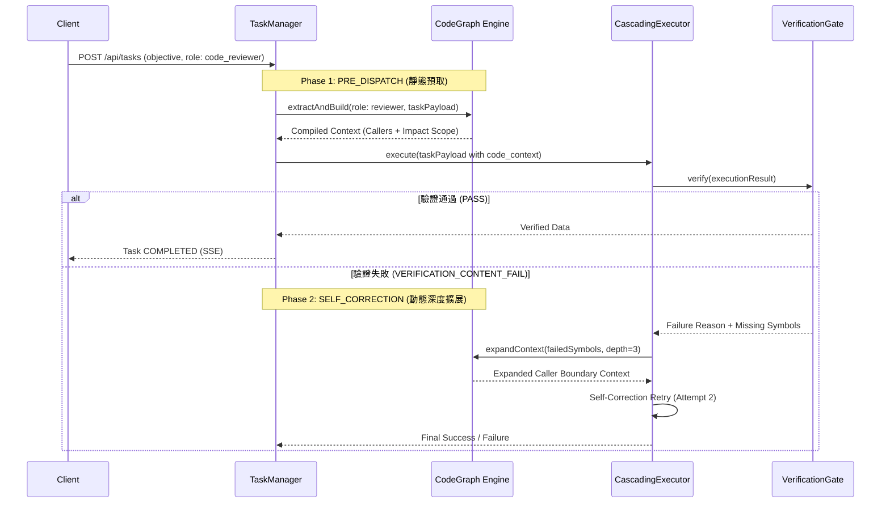

# 🧭 Phase 1-C Engineering PRD
## CodeGraph-Powered Role-Aware & Task-Aware Context Retrieval Engine

**專案**：`model-hub-agent` (Antigravity Agent OS 核心)  
**階段**：Phase 1-C (P1-C)  
**起點基準**：`main @ e88276f` (`v1.4.0-phase-1-consolidated`)  
**開發分支**：`feature/p1-c-codegraph-retrieval`  
**目標發布**：`v1.5.0-phase-1c-codegraph`  
**負責架構師**：Antigravity Agent OS 核心架構組 (etrnya)  
**制定日期**：2026-11-04  
**狀態**：APPROVED & UNDER IMPLEMENTATION  

---

## 🎯 執行摘要與核心目標 (Executive Summary & Mission)

在 Phase 1 前期，Agent OS 已成功建立具備容錯熔斷的 **P0-B 可靠性層**、專業分工的 **P1-A 角色模板層**，以及受限排隊與 SSE 可觀測性的 **P1-B 任務執行層**。

然而，現有的 Agent OS 在面對代碼任務時，主要依賴呼叫者手動傳入 `code_context`，或依賴 LLM 大規模閱讀未經篩選的檔案內容，這會導致：
1. **上下文渙散與污染**：將大量無關程式碼塞入 Prompt，使模型產生注意力漂移 (Attention Drift) 與代碼幻覺。
2. **Token 成本失控**：無差別注入原始檔造成 Token 浪費，觸發 Context Compressor 的有損截斷。
3. **缺乏物理證據鏈 (Provenance)**：模型無法精準確知修改某函式對上下游造成的衝擊範圍。

### P1-C 的核心目標：
> **從「依賴模型通讀代碼」進化為「依據任務需求與角色職責，動態擷取精準且具備物理證據鏈的程式碼依賴脈絡 (Evidence-Driven Context Retrieval)」。**

---

## 🏛️ 一、 現有架構盤點 (Current Architecture Inventory)

```mermaid
graph TD
    subgraph "Phase 1 Existing Baseline (v1.4.0)"
        RM[RoleManager (services/role_manager.js)]
        TM[TaskManager (services/task_manager.js)]
        CE[CascadingExecutor (services/cascading_executor.js)]
        VG[VerificationGate (services/verification_gate.js)]
        GS[GlobalState (shared/global_state.js)]
    end

    subgraph "P1-C New Modules"
        CGA[CodeGraphAdapter (infrastructure/adapters/codegraph_adapter.js)]
        RCP[RoleAwareContextPlanner (services/context_planner.js)]
        CC[ContextCompiler (services/context_compiler.js)]
    end

    TM -->|1. Submit Task| RCP
    RM -.->|Role Definition| RCP
    RCP -->|2. Plan Query| CGA
    CGA -->|3. AST / CallGraph / Impact| CC
    CC -->|4. Compiled Evidence Context| TM
    TM -->|5. Dispatch with code_context| CE
    CE -->|6. Execution Result| VG
    VG -.->|7. Correction Feedback| RCP
```

### 現有組件現狀與介面盤點：
1. **`RoleManager` (`services/role_manager.js`)**：
   - 負責驗證與載入內建三大角色：`software_architect`、`code_reviewer`、`doc_synthesizer`。
   - 現況：已具備元 Schema 與輸出 Schema 校驗，但角色定義中未包含「上下文檢索策略 (Retrieval Strategy)」。
2. **`TaskManager` (`services/task_manager.js`)**：
   - 負責有限併發任務排隊（`MAX_CONCURRENCY=2`, `MAX_QUEUE=10`）與生命週期 SSE 廣播。
   - 現況：`submitTask(userInput)` 僅被動接收 `userInput.code_context`；若使用者未提供，則 `taskPayload.code_context` 為空。
3. **`CodeGraphAdapter` (`infrastructure/adapters/codegraph_adapter.js`)**：
   - 現狀程式碼量 237 行，已封裝基礎 `codegraph` CLI 指令：`findSymbol`、`findCallers`、`getFeatureContext`、`_readCodeSnippet`。
   - 痛點：
     - 未支援新版 `codegraph impact <symbol> --json` 分析。
     - 符號抽取僅依賴粗暴的正規表示式篩選，缺乏角色導向。
     - 缺乏 Token 預算控制，可能產生過長 Markdown。
     - 缺乏離線單元測試與 Mock 機制，無法納入全域 CI 迴歸。

---

## 🧩 二、 模組介面與依賴關係 (Interfaces & Dependencies)

### 1. `CodeGraphAdapter` (底層 AST 與圖譜適配器)
```typescript
interface CodeGraphAdapter {
  // 索引健康與同步
  syncIndex(): Promise<{ success: boolean; modifiedCount: number }>;
  getStatus(): Promise<CodeGraphStatus>;

  // 符號與圖譜查詢 (直接對齊 codegraph CLI JSON 輸出)
  querySymbols(query: string, options?: { limit?: number; kind?: string }): Promise<Array<CodeGraphNode>>;
  findCallers(symbol: string, depth?: number): Promise<Array<CallerRelation>>;
  findCallees(symbol: string, depth?: number): Promise<Array<CalleeRelation>>;
  analyzeImpact(symbol: string, depth?: number): Promise<ImpactAnalysisResult>;

  // 物理程式碼片段安全讀取 (嚴格沙盒限制)
  readCodeSnippet(filePath: string, startLine: number, endLine: number): Promise<string>;
}
```

### 2. `RoleAwareContextPlanner` (角色導向檢索規劃器)
```typescript
interface RoleAwareContextPlanner {
  /**
   * 依據角色定義與任務目標，規劃專屬的檢索請求集合
   */
  plan(roleId: string | null, taskPayload: TaskPayload): RetrievalPlan;
}

interface RetrievalPlan {
  roleId: string | null;
  policy: 'ARCHITECTURE_TOPOLOGY' | 'BLAST_RADIUS_AND_CALLERS' | 'INTERFACE_AND_DOCSTRINGS' | 'BALANCED_SYMBOLS';
  targetSymbols: Array<string>;
  traversalDepth: number;
  includeSnippets: boolean;
  maxTokens: number;
}
```

### 3. `ContextCompiler` (上下文編譯與預算守護器)
```typescript
interface ContextCompiler {
  /**
   * 將圖譜節點、呼叫關係與程式碼片段編譯為結構化 Markdown，並嚴格限制於 Token 預算內
   */
  compile(plan: RetrievalPlan, rawData: RawRetrievalData): CompiledContextResult;
}

interface CompiledContextResult {
  markdown: string;
  tokenCountEstimate: number;
  provenance: Array<SourceEvidence>;
  truncated: boolean;
}
```

---

## 📊 三、 CodeGraph 資料模型 (Data Models)

### 1. `CodeGraphNode` (語法樹節點)
```json
{
  "id": "class:961ecca9c26a310951a07c5496c14391",
  "kind": "class",
  "name": "TaskManager",
  "qualifiedName": "TaskManager",
  "filePath": "services/task_manager.js",
  "language": "javascript",
  "startLine": 22,
  "endLine": 344,
  "signature": "(options = {})",
  "docstring": "受限非同步任務管理器 (Bounded In-Memory Asynchronous Task Manager)",
  "isExported": true,
  "isAsync": false
}
```

### 2. `ImpactAnalysisResult` (影響力與爆炸半徑)
```json
{
  "symbol": "TaskManager",
  "depth": 2,
  "nodeCount": 16,
  "edgeCount": 16,
  "blastRadius": "HIGH",
  "affected": [
    { "name": "server.js", "kind": "file", "filePath": "server.js", "startLine": 1 },
    { "name": "runAll", "kind": "function", "filePath": "tests/test_async_task_integration.js", "startLine": 57 }
  ]
}
```

### 3. `SourceEvidence` (物理證據鏈)
```json
{
  "symbol": "TaskManager::_pumpQueue",
  "filePath": "services/task_manager.js",
  "lineRange": [194, 208],
  "verifiedInIndex": true,
  "sha256": "e3b0c44298fc1c149afbf4c8996fb92427ae41e4649b934ca495991b7852b855"
}
```

---

## 🎭 四、 Role-Aware Context Retrieval 設計 (角色檢索矩陣)

不同角色在系統開發中承擔不同的認知任務，必須配置完全正交的上下文擷取策略：

```text
+-----------------------------------------------------------------------------------+
|                           Role-Aware Retrieval Matrix                             |
+--------------------+----------------------------+---------------------------------+
| 角色 (Role)        | 上下文策略 (Policy)        | 擷取範疇與排除規則              |
+--------------------+----------------------------+---------------------------------+
| software_architect | ARCHITECTURE_TOPOLOGY      | • 模組拓撲 (File Structure)     |
| (軟體架構師)       |                            | • 導出類別 (Exported Classes)   |
|                    |                            | • 高階呼叫關係 (CallGraph D=2)  |
|                    |                            | 🚫 排除單行實作細節與局部變數   |
+--------------------+----------------------------+---------------------------------+
| code_reviewer      | BLAST_RADIUS_AND_CALLERS   | • 目標函式修改點 (Diff Target)  |
| (代碼審查員)       |                            | • 上游調用端 (Callers D=2)      |
|                    |                            | • 下游依賴 (Callees D=1)        |
|                    |                            | • 影響力分析 (Impact Analysis)  |
|                    |                            | 🚫 排除無關模組的全域架構大綱   |
+--------------------+----------------------------+---------------------------------+
| doc_synthesizer    | INTERFACE_AND_DOCSTRINGS   | • 函式簽章 (Signatures)         |
| (技術文檔合成器)   |                            | • JSDoc 與型別註解              |
|                    |                            | • 公開 Export API 列表          |
|                    |                            | 🚫 折疊內部函數體 (超過 3 行)   |
+--------------------+----------------------------+---------------------------------+
| default / general  | BALANCED_SYMBOLS           | • 關鍵符號定義與對應程式碼片段  |
+--------------------+----------------------------+---------------------------------+
```

---

## 🔄 五、 Task-Aware Dynamic Retrieval 設計 (任務生命週期連動)



### 動態擴展規則：
1. **初次派發 (Pre-Dispatch)**：提取目標符號，依據角色限制在深度 `depth=1`，Token 預算限制在 2,000 tokens 以內。
2. **自我修正觸發 (Self-Correction Triggered)**：
   - 當 `VerificationGate` 拋出 `VERIFICATION_CONTENT_FAIL`（如偵測到呼叫參數不符或呼叫了不存在的函式）。
   - 提取審計報告中的報錯符號，動態將檢索深度擴展至 `depth=2~3`，並注入受影響呼叫端的完整原始碼片段（上限擴增至 4,000 tokens），為第二輪修復提供決定性證據。

---

## 🗜️ 六、 Context Compiler 與 Token 預算控制 (Context Compiler)

為了防止上下文無限膨脹擊穿模型視窗，`ContextCompiler` 實作兩道防線：

### 1. 相關性評分公式 (Relevance Scoring)
$$\text{Score}(N) = 0.4 \times \text{ExactMatch} + 0.3 \times \frac{1}{\text{Depth} + 1} + 0.3 \times \text{RoleWeight}(N)$$

* `ExactMatch`：任務目標中完全命中符號名稱為 1.0，模糊匹配為 0.5。
* `Depth`：距離目標符號之呼叫層級（0 = 目標本身, 1 = 直接 Caller/Callee）。
* `RoleWeight`：與角色策略的適配度（例如 `code_reviewer` 對 `ImpactNode` 賦予 1.0）。

### 2. 硬上限截斷與降級階梯 (Budget Guard & Fallback)
* 預設預算：`MAX_CODE_CONTEXT_TOKENS = 3000` (約 12,000 字元)。
* 超過預算時的降級優先順序：
  1. 優先保留：目標符號簽章、檔案路徑與行號。
  2. 次要保留：直接 Callers/Callees 拓撲清單。
  3. 優先截斷：下游模組之詳細原始碼實作內容（降級為 `// [Implementation truncated for budget: 45 lines]`）。
  4. 注入提示：`⚠️ [Context Notice]: 3 peripheral code snippets were truncated due to token budget constraint.`。

---

## 🛡️ 七、 資安威脅模型與沙盒邊界 (Security Threat Model)

| 威脅代號 | 威脅描述 (Threat) | 攻擊途徑 (Attack Vector) | 核心防禦措施 (Mitigation) |
| :--- | :--- | :--- | :--- |
| **STRIDE-T1** | **路徑穿越 (Path Traversal)** | 惡意任務目標傳入 `../../etc/passwd` 或 Windows `..\..\Windows` 試圖讀取系統檔。 | 嚴格使用 `path.resolve` 比對，目標路徑必須以 `projectPath` 為前綴；禁止讀取 `.git/` 與 `.env`。 |
| **STRIDE-T2** | **指令注入 (Command Injection)** | 符號中夾帶 `; rm -rf /` 或 `& calc.exe` 注入至 `codegraph` CLI。 | 符號名稱強制執行白名單正規表達式：`^[a-zA-Z0-9_:.\\-]+$`；特殊字元直接剝離拒絕。 |
| **STRIDE-T3** | **任意代碼執行 (Code Execution)** | 在檢索過程中對專案檔案進行 `eval()` 或動態 `require()`。 | **嚴格禁止**動態載入被檢索的程式碼；僅透過 SQLite 與唯讀文字串流解析 AST。 |
| **STRIDE-T4** | **機密資訊外流 (Secret Leak)** | 程式碼片段中含有本機 API Key 或密鑰，直接洩漏至 Prompt。 | 與既有 `GuardrailManager` 整合，所有提取的 Snippet 輸出前強制經過 DLP 敏感資訊脫敏過濾。 |

---

## 🗓️ 八、 里程碑拆解與驗收標準 (Milestones & Acceptance Criteria)

### 📌 P1-C1｜AST Indexing & Adapter Hardening (基礎適配層加固)
* **交付內容**：
  - 重構 `CodeGraphAdapter`，支援 `codegraph sync`、`getStatus()`、`analyzeImpact()`。
  - 實作指令輸入防注入白名單校驗。
  - 實作路徑穿越邊界防禦（禁止逃逸專案根目錄）。
* **驗收標準**：
  - 建立 `tests/test_codegraph_adapter.js`，離線覆蓋所有 CLI 輸出解析與錯誤防禦。

### 📌 P1-C2｜Call Graph & Impact Analysis Engine (圖譜與衝擊分析)
* **交付內容**：
  - 實作雙向 Call Graph 查詢（Callers + Callees）。
  - 實作 Blast Radius 衝擊等級判定演算法（LOW / MEDIUM / HIGH）。
  - 實作檔案與行號精準定位（含程式碼片段物理讀取與行號校驗）。
* **驗收標準**：
  - 建立確定性呼叫關係測試，精確斷言 `TaskManager` 的修改會衝擊 `server.js` 與測試套件。

### 📌 P1-C3｜Role-Aware Retrieval & Context Compiler (角色導向編譯)
* **交付內容**：
  - 實作 `services/context_planner.js`：架構師、代碼審查員、文檔合成器三種策略。
  - 實作 `services/context_compiler.js`：相關性排序、Token 預算限制、物理證據鏈標註。
* **驗收標準**：
  - 建立 `tests/test_codegraph_role_aware.js`：針對同一任務目標，斷言三種角色產出之 Context 結構完全符合正交設計。

### 📌 P1-C4｜Task-Aware Dynamic Context Pipeline (全管線閉環整合)
* **交付內容**：
  - 將 Context Planner 深度接入 `TaskManager.submitTask` 與 `server.js`。
  - 當收到任務且未帶 `code_context` 時，自動非阻塞執行 Role-Aware 預取。
  - 與 `VerificationGate` 連動，實作失敗自我修正時的動態上下文擴展。
* **驗收標準**：
  - 建立端到端整合測試 `tests/test_codegraph_task_integration.js`。
  - 納入 `run_tests.js`（擴充至 15 套測試），且 Phase 1 既有 14 套維持 100% 綠燈。

---

## 🧪 九、 測試矩陣與自動化斷言設計 (Test Matrix)

| 測試代號 | 測試套件 | 測試情境與斷言重點 | 執行方式 |
| :--- | :--- | :--- | :---: |
| **CG-1** | `test_codegraph_adapter.js` | 符號查詢、防注入特殊字元剝離、找不到符號時的優雅 Fallback | 確定性離線 Mock |
| **CG-2** | `test_codegraph_adapter.js` | 路徑穿越防護：`../../package.json` 必須被拒絕，禁止跨目錄讀取 | 實體檔案邊界斷言 |
| **CG-3** | `test_codegraph_impact.js` | 衝擊分析：驗證 `TaskManager` 變更之 `affected` 節點與 Blast Radius 判定 | 確定性圖譜斷言 |
| **CG-4** | `test_codegraph_role_aware.js` | 角色差異化：架構師無細節程式碼、審查員有 Callers 與衝擊、文檔者無函數體 | 結構與欄位比對 |
| **CG-5** | `test_codegraph_compiler.js` | 預算守護：超長代碼片段必須依優先級剪枝，並保留來源證據鏈標註 | Token 統計斷言 |
| **CG-6** | `test_codegraph_integration.js` | 端到端整合：`POST /api/tasks` 帶角色自動生成 code_context 並執行成功 | HTTP 整合測試 |

---

## ⚠️ 十、 已知限制與架構風險 (Known Limitations & Risks)

1. **依賴本機 `codegraph` CLI 環境**：
   - CodeGraph 為本地 Node.js 工具。若在未安裝 `codegraph` 的乾淨環境運行，`CodeGraphAdapter` 必須提供優雅降級（Fallback to empty context），**絕不得因此阻斷基礎模型調度**。
2. **大型程式庫首次索引延遲**：
   - 首次全量索引可能耗費數秒；我們採用 `codegraph sync` 增量同步機制，在背景定期或啟動時同步，避免阻塞即時 API 響應。
3. **多語言邊界**：
   - 目前 CodeGraph 支援 JavaScript、TypeScript、Python、Rust 等語法樹；對於其他特殊語言檔案，將退化為檔案級純文字檢索。
