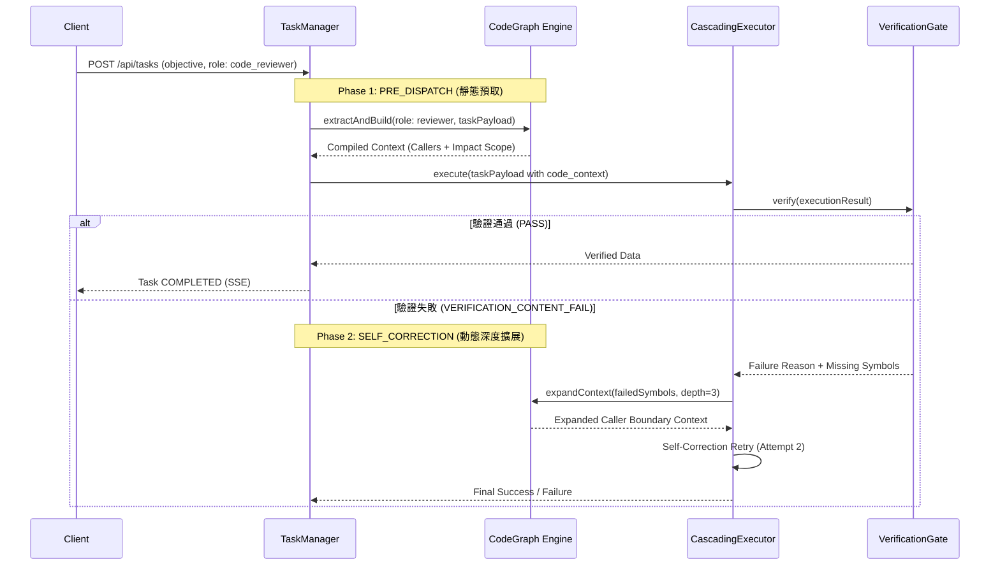

# 🧭 Phase 1-C Engineering PRD
## CodeGraph-Powered Role-Aware & Task-Aware Context Retrieval Engine

**專案**：`model-hub-agent` (Antigravity Agent OS 核心)  
**階段**：Phase 1-C (P1-C)  
**起點基準**：`main @ e88276f` (`v1.4.0-phase-1-consolidated`)  
**開發分支**：`feature/p1-c-codegraph-retrieval`  
**目標發布**：`v1.5.0-phase-1c-codegraph`  
**負責架構師**：Antigravity Agent OS 核心架構組 (etrnya)  
**制定日期**：2026-11-04  
**狀態**：REVIEWED / P1-C1 AUTHORIZED (P1-C2~C4 PENDING)  

---

## 🎯 執行摘要與核心目標 (Executive Summary & Mission)

在 Phase 1 前期，Agent OS 已成功建立具備容錯熔斷的 **P0-B 可靠性層**、專業分工的 **P1-A 角色模板層**，以及受限排隊與 SSE 可觀測性的 **P1-B 任務執行層**。

然而，現有的 Agent OS 在面對代碼任務時，主要依賴呼叫者手動傳入 `code_context`，或依賴 LLM 大規模閱讀未經篩選的檔案內容，這會導致：
1. **上下文渙散與污染**：將大量無關程式碼塞入 Prompt，使模型產生注意力漂移 (Attention Drift) 與代碼幻覺。
2. **Token 成本失控**：無差別注入原始檔造成 Token 浪費，觸發 Context Compressor 的有損截斷。
3. **缺乏物理證據鏈 (Provenance)**：模型無法精準確知修改某函式對上下游造成的衝擊範圍。

### P1-C 的核心目標：
> **從「依賴模型通讀代碼」進化為「依據任務需求與角色職責，動態擷取精準且具備物理證據鏈的程式碼依賴脈絡 (Evidence-Driven Context Retrieval)」。**

---

## 🏛️ 一、 現有架構盤點 (Current Architecture Inventory)

```mermaid
graph TD
    subgraph "Phase 1 Existing Baseline (v1.4.0)"
        RM[RoleManager (services/role_manager.js)]
        TM[TaskManager (services/task_manager.js)]
        CE[CascadingExecutor (services/cascading_executor.js)]
        VG[VerificationGate (services/verification_gate.js)]
        GS[GlobalState (shared/global_state.js)]
    end

    subgraph "P1-C New Modules"
        CGA[CodeGraphAdapter (infrastructure/adapters/codegraph_adapter.js)]
        CGS[CodeGraphSchemas (infrastructure/adapters/codegraph_schemas.js)]
        RCP[RoleAwareContextPlanner (services/context_planner.js - PENDING)]
        CC[ContextCompiler (services/context_compiler.js - PENDING)]
    end

    CGA --> CGS
    TM -->|1. Submit Task| RCP
    RM -.->|Role Definition| RCP
    RCP -->|2. Plan Query| CGA
    CGA -->|3. AST / CallGraph / Impact| CC
    CC -->|4. Compiled Evidence Context| TM
    TM -->|5. Dispatch with code_context| CE
    CE -->|6. Execution Result| VG
    VG -.->|7. Correction Feedback| RCP
```

### 現有組件現狀與介面盤點：
1. **`RoleManager` (`services/role_manager.js`)**：
   - 負責驗證與載入內建三大角色：`software_architect`、`code_reviewer`、`doc_synthesizer`。
   - 現況：已具備元 Schema 與輸出 Schema 校驗，但角色定義中未包含「上下文檢索策略 (Retrieval Strategy)」。
2. **`TaskManager` (`services/task_manager.js`)**：
   - 負責有限併發任務排隊（`MAX_CONCURRENCY=2`, `MAX_QUEUE=10`）與生命週期 SSE 廣播。
   - 現況：`submitTask(userInput)` 僅被動接收 `userInput.code_context`；若使用者未提供，則 `taskPayload.code_context` 為空。
3. **`CodeGraphAdapter` (`infrastructure/adapters/codegraph_adapter.js`)**：
   - 現狀程式碼量 237 行，已封裝基礎 `codegraph` CLI 指令。
   - 初審發現的重大痛點與安全盲點：
     - 使用 `child_process.exec()` 命令字串拼接，有 Shell 注入風險。
     - 檔案片段讀取缺乏路徑穿越檢查、符號連結逃逸防範、黑名單檔案攔截、行數與大小上限限制。
     - 缺乏 JSON Schema 實體校驗，可能因 CLI 回傳欄位變更導致未攔截例外。
     - 缺乏狀態機管理與併發同步保護。
     - 缺乏確定性單元 Mock 與合約測試覆蓋。

---

## 🧩 二、 模組介面與生命週期 (Interfaces & Lifecycle)

### 1. `CodeGraphAdapter` (加固版適配器規範)
```typescript
interface CodeGraphAdapter {
  // 索引健康與生命週期同步
  syncIndex(): Promise<{ success: boolean; modifiedCount: number; status: string }>;
  getStatus(): Promise<CodeGraphStatus>;

  // 符號與圖譜查詢 (直接對齊 codegraph CLI JSON 輸出，含 Schema 驗證)
  querySymbols(query: string, options?: { limit?: number; kind?: string }): Promise<Array<CodeGraphNode>>;
  findCallers(symbol: string, depth?: number): Promise<CallerRelationResult>;
  findCallees(symbol: string, depth?: number): Promise<CalleeRelationResult>;
  analyzeImpact(symbol: string, depth?: number): Promise<ImpactAnalysisResult>;

  // 物理程式碼片段安全讀取 (嚴格沙盒限制，包含雙重雜湊與真實路徑解析)
  readCodeSnippet(filePath: string, startLine: number, endLine: number): Promise<{
    content: string;
    lineCount: number;
    fileSha256: string;
    snippetSha256: string;
  }>;
}
```

### 2. 索引同步生命週期 (Index Lifecycle State Machine)
`CodeGraphAdapter` 內部維護確定性狀態機：
```
[IDLE] ──(syncIndex start)──> [SYNCING] ──(success)──> [READY]
                                  │
                              (failure)
                                  ↓
                             [DEGRADED] (保留前一份有效狀態，不阻斷外部呼叫)
```
- **併發防禦**：若 `syncIndex()` 執行中被重複呼叫，適配器會返回當前進行中的同一 Promise，避免並發執行多重 CLI 造成 SQLite 寫入衝突。
- **降級容錯**：若同步失敗，狀態切換為 `DEGRADED`，保留記憶體中的最後一次成功快照，向外報告錯誤日誌但不中斷 Agent OS 運作。

---

## 📊 三、 CodeGraph 資料模型與 Schema (Data Models & Schemas)

在 `infrastructure/adapters/codegraph_schemas.js` 中明確定義並斷言以下五大 Schema：

### 1. `CodeGraphNodeSchema` (語法樹節點)
```typescript
interface CodeGraphNode {
  id: string;               // 節點唯一識別碼 (kind:hash)
  name: string;             // 符號名稱
  qualifiedName: string;    // 完整限定名稱 (e.g. TaskManager::_pumpQueue)
  kind: 'function' | 'method' | 'class' | 'variable' | 'interface' | 'file';
  filePath: string;         // 相對於專案根目錄之路徑
  language: string;         // 語言類型
  startLine: number;        // 起始行 (>= 1)
  endLine: number;          // 結束行 (>= startLine)
  signature?: string;       // 簽章
  docstring?: string;       // 文檔註解
  isExported?: boolean;     // 是否導出
  isAsync?: boolean;        // 是否非同步
}
```

### 2. `CallerRelationSchema` & `CalleeRelationSchema`
```typescript
interface CallerRelationResult {
  symbol: string;
  callers: Array<{
    name: string;
    qualifiedName?: string;
    filePath: string;
    startLine: number;
    endLine: number;
    kind?: string;
  }>;
}

interface CalleeRelationResult {
  symbol: string;
  callees: Array<{
    name: string;
    qualifiedName?: string;
    filePath: string;
    startLine: number;
    endLine: number;
    kind?: string;
  }>;
}
```

### 3. `ImpactAnalysisSchema` (衝擊分析)
```typescript
interface ImpactAnalysisResult {
  symbol: string;
  depth: number;
  nodeCount: number;
  edgeCount: number;
  blastRadius: 'LOW' | 'MEDIUM' | 'HIGH';
  affected: Array<{
    name: string;
    kind: string;
    filePath: string;
    startLine: number;
  }>;
}
```

### 4. `CodeGraphStatusSchema` (索引庫狀態)
```typescript
interface CodeGraphStatus {
  nodeCount: number;
  edgeCount: number;
  fileCount: number;
  status: string;
  dbPath?: string;
  version?: string;
}
```

### 5. `SourceEvidence` (物理證據鏈與雙重雜湊)
```typescript
interface SourceEvidence {
  symbol: string;
  filePath: string;
  lineRange: [number, number];
  fileSha256: string;       // 來源檔案全文雜湊
  snippetSha256: string;    // 實際擷取程式碼片段雜湊
  verifiedInIndex: boolean; // 是否在 AST 索引中精確存在
  indexGeneratedAt: string; // 索引生成時間戳記
}
```

---

## 🎭 四、 Role-Aware Context Retrieval 設計 (角色檢索矩陣 - 規劃於 P1-C3)

不同角色在系統開發中承擔不同的認知任務，必須配置完全正交的上下文擷取策略：

```text
+-----------------------------------------------------------------------------------+
|                           Role-Aware Retrieval Matrix                             |
+--------------------+----------------------------+---------------------------------+
| 角色 (Role)        | 上下文策略 (Policy)        | 擷取範疇與排除規則              |
+--------------------+----------------------------+---------------------------------+
| software_architect | ARCHITECTURE_TOPOLOGY      | • 模組拓撲 (File Structure)     |
| (軟體架構師)       |                            | • 導出類別 (Exported Classes)   |
|                    |                            | • 高階呼叫關係 (CallGraph D=2)  |
|                    |                            | 🚫 排除單行實作細節與局部變數   |
+--------------------+----------------------------+---------------------------------+
| code_reviewer      | BLAST_RADIUS_AND_CALLERS   | • 目標函式修改點 (Diff Target)  |
| (代碼審查員)       |                            | • 上游調用端 (Callers D=2)      |
|                    |                            | • 下游依賴 (Callees D=1)        |
|                    |                            | • 影響力分析 (Impact Analysis)  |
|                    |                            | 🚫 排除無關模組的全域架構大綱   |
+--------------------+----------------------------+---------------------------------+
| doc_synthesizer    | INTERFACE_AND_DOCSTRINGS   | • 函式簽章 (Signatures)         |
| (技術文檔合成器)   |                            | • JSDoc 與型別註解              |
|                    |                            | • 公開 Export API 列表          |
|                    |                            | 🚫 折疊內部函數體 (超過 3 行)   |
+--------------------+----------------------------+---------------------------------+
| default / general  | BALANCED_SYMBOLS           | • 關鍵符號定義與對應程式碼片段  |
+--------------------+----------------------------+---------------------------------+
```

---

## 🔄 五、 Task-Aware Dynamic Retrieval 設計 (任務生命週期連動 - 規劃於 P1-C4)



---

## 🗜️ 六、 Context Compiler 與 Token 預算控制 (規劃於 P1-C3)

為了防止上下文無限膨脹擊穿模型視窗，`ContextCompiler` 實作兩道防線：

### 1. 相關性評分公式 (Relevance Scoring)
$$\text{Score}(N) = 0.4 \times \text{ExactMatch} + 0.3 \times \frac{1}{\text{Depth} + 1} + 0.3 \times \text{RoleWeight}(N)$$

### 2. 硬上限截斷與降級階梯 (Budget Guard & Fallback)
* 預設預算：`MAX_CODE_CONTEXT_TOKENS = 3000` (約 12,000 字元)。
* 降級優先級：保留目標簽章與主要 Callers，截斷邊緣實作內容。

---

## 🛡️ 七、 資安威脅模型與防禦規範 (Security & Hardening Specifications)

依據初審裁決要求，本階段落實五項關鍵安全防衛規範：

### 1. 路徑穿越與符號連結逃逸防護 (Path Traversal & Symlink Defense)
- **禁止單純前綴比對**：嚴格禁止 `targetPath.startsWith(projectRoot)`，防範 `/app/project-secret/.env` 偽前綴攻擊。
- **路徑標準化判定演算法**：
  ```javascript
  const resolvedPath = path.resolve(this.projectPath, filePath);
  const relative = path.relative(this.projectPath, resolvedPath);
  const isInside = relative !== '' && !relative.startsWith('..') && !path.isAbsolute(relative);
  if (!isInside) {
    throw new CodeGraphSecurityError('PATH_TRAVERSAL_DETECTED', `Path ${filePath} is outside project root`);
  }
  ```
- **Symlink 解析**：在讀取前使用 `fs.realpath` 解析符號連結目標真實路徑，並對真實路徑再次執行 `path.relative` 判定，徹底防止專案內 symlink 指向專案外敏感資源。
- **黑名單路徑攔截**：
  - 封鎖路徑包含：`.git/`, `.git\\`, `.env`, `node_modules/` (視配置), `id_rsa`, `id_ed25519`。
  - 封鎖副檔名：`*.pem`, `*.key`, `*.pfx`, `*.crt`, `*.p12`。
- **程式碼讀取配額與防護**：
  - `startLine >= 1`, `endLine >= startLine`。
  - 單次讀取上限：最多 500 行 (`endLine - startLine + 1 <= 500`)。
  - 檔案大小上限：單檔最大 1MB (`stat.size <= 1024 * 1024`)。
  - 二進位檔案防範：檢查檔案前 8,000 位元組是否包含 Null Byte (`0x00`)，若是則拒絕讀取並報錯 `BINARY_FILE_REJECTED`。

### 2. CLI 指令注入防禦 (Command Injection Defense)
- **全面禁止 Shell 拼接**：嚴格禁止 `child_process.exec()`，所有 CLI 呼叫全面改用 `child_process.execFile()`，以無 Shell（`shell: false`）模式執行。
- **固定執行檔與陣列傳參**：預設執行檔為 `codegraph`，所有參數皆以獨立字串陣列元素傳入。
- **符號白名單嚴格校驗**：
  - 輸入符號強制比對正規表達式：`^[a-zA-Z0-9_:.\\-]+$`。
  - 包含空白、引號、分號、管道符號等非法字元者直接拒絕，拋出 `INVALID_SYMBOL`。
- **執行超時與緩衝區防禦**：
  - 子程序超時限制：`timeout: 5000` (5 秒)。
  - 最大緩衝區限制：`maxBuffer: 5 * 1024 * 1024` (5MB)。

### 3. 標準化錯誤分類 (Standardized Error Taxonomy)
適配器拋出或捕獲之錯誤統一標準化為下列代碼：
- `CLI_NOT_FOUND`：找不到 `codegraph` 執行檔。
- `CLI_TIMEOUT`：CLI 執行超過 5000ms。
- `CLI_NON_ZERO_EXIT`：CLI 回傳非 0 狀態碼。
- `CLI_OUTPUT_TOO_LARGE`：輸出超過 5MB 緩衝區。
- `CLI_INVALID_JSON`：輸出非合法 JSON 格式。
- `SCHEMA_VALIDATION_ERROR`：CLI 輸出結構與 Schema 不符。
- `PATH_TRAVERSAL_DETECTED`：目標路徑試圖逃逸專案根目錄。
- `INVALID_SYMBOL`：符號含有非法字元。
- `FILE_ACCESS_DENIED`：命中黑名單檔案或無權限存取。
- `FILE_TOO_LARGE`：目標檔案超過 1MB。
- `BINARY_FILE_REJECTED`：目標檔案為二進位檔案。

---

## 🗓️ 八、 里程碑拆解與授權邊界 (Milestones & Authorization Boundary)

```text
[P1-C1: AST Indexing & Hardening]  <── 🎯【目前執行階段：唯一已授權】
   │  • CodeGraphSchemas 實作與驗證
   │  • CodeGraphAdapter execFile 與防注入
   │  • 路徑穿越 / Symlink / 黑名單 / 500行安全讀取
   │  • Tier 1 (Mock) + Tier 2 (Local Contract) 測試
   │
   ▼ ── [門禁審查：需用戶獨立裁決放行]
[P1-C2: Call Graph & Impact Engine] (PENDING)
   │
   ▼
[P1-C3: Role-Aware Retrieval & Compiler] (PENDING)
   │
   ▼
[P1-C4: Task-Aware Dynamic Pipeline] (PENDING)
```

- **P1-C1 驗收標準**：
  1. `infrastructure/adapters/codegraph_schemas.js` 通過所有 Schema 斷言。
  2. `infrastructure/adapters/codegraph_adapter.js` 全面移除 `exec`，採用 `execFile`。
  3. `tests/test_codegraph_adapter.js` 涵蓋正常、異常、注入、穿越、逾時、合約測試。
  4. 整合至 `tests/run_tests.js`（全套 15 套測試 100% PASS）。

---

## 🧪 九、 測試矩陣 (Test Matrix)

| 測試代號 | 測試項目 | 測試情境與斷言重點 | 執行方式 |
| :--- | :--- | :--- | :---: |
| **C1-T1** | 符號白名單驗證 | 惡意符號 `test; rm -rf` 或 `foo & calc` 必須被拒絕，拋出 `INVALID_SYMBOL` | 離線單元 |
| **C1-T2** | 路徑穿越防護 | `../../package.json`、偽前綴 `project-secret` 必須被攔截 | 實體路徑計算 |
| **C1-T3** | Symlink 逃逸防禦 | 專案內 symlink 指向專案外檔案，解析真實路徑後必須攔截 | 符號連結驗證 |
| **C1-T4** | 黑名單與檔案限制 | 讀取 `.env`、超過 500 行、超過 1MB、二進位檔必須被拒絕 | 沙盒邊界斷言 |
| **C1-T5** | CLI 異常與逾時 | 模擬 5000ms 超時、Non-zero exit、畸形 JSON，驗證錯誤封裝 | Mock Runner |
| **C1-T6** | Schema 實體驗證 | CLI 回傳缺失欄位或型別錯誤時，拋出 `SCHEMA_VALIDATION_ERROR` | Schema 校驗 |
| **C1-T7** | 本機 CLI 合約測試 | 呼叫本地真實 `codegraph status` 與 `query`，確認契約完全對齊 | 本機合約測試 |

---

## ⚠️ 十、 已知限制與架構風險 (Known Limitations & Risks)

1. **依賴本機 `codegraph` CLI 環境**：
   - CodeGraph 為本地 Node.js 工具。若在未安裝 `codegraph` 的乾淨環境運行，`CodeGraphAdapter` 必須提供優雅降級（Fallback to empty context），**絕不得因此阻斷基礎模型調度**。
2. **大型程式庫首次索引延遲**：
   - 首次全量索引可能耗費數秒；我們採用 `codegraph sync` 增量同步機制，在背景定期或啟動時同步，避免阻塞即時 API 響應。
3. **多語言邊界**：
   - 目前 CodeGraph 支援 JavaScript、TypeScript、Python、Rust 等語法樹；對於其他特殊語言檔案，將退化為檔案級純文字檢索。
