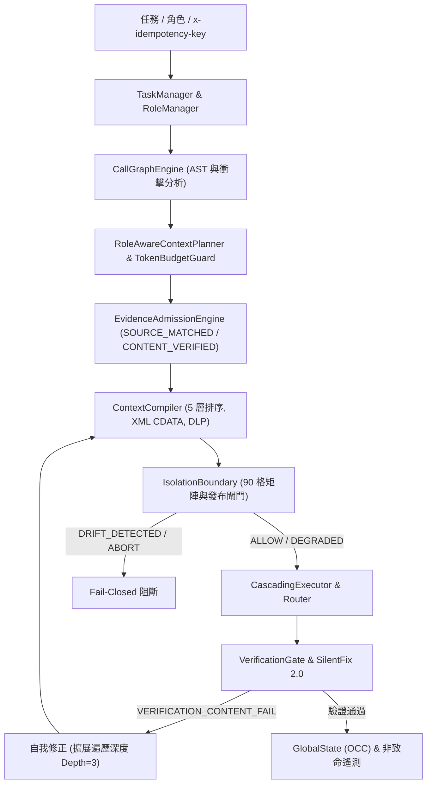

# Antigravity Agent OS — 證據優先的 AI Agent 基礎設施

[English](README.md) | [繁體中文](README_ZH.md)

[](https://opensource.org/licenses/Apache-2.0)
[](package.json)

**Antigravity Agent OS** 是一套**證據優先的 AI Agent 基礎設施 (Evidence-First Agent Infrastructure)**——專注於協助 AI Agent 在嚴格的 Token 預算內，取得來源可信、可追溯且經隔離驗證的上下文證據，並結合多模型級聯容災與冪等控制。

## 🌟 核心價值

### 證據優先上下文基礎設施 (P1-C1 ~ P1-C4)
-   **AST 呼叫圖與衝擊分析 (`CallGraphEngine`)**：在模型調度前執行雙向 Caller/Callee 拓撲展開與影響範圍評估（`assessedBlastRadius`、`analysisCompleteness`）。
-   **角色感知規劃與預算守衛 (`RoleAwareContextPlanner` / `TokenBudgetGuard`)**：依角色與任務類型動態規劃檢索深度，強制執行 3,000 Token 硬上限與三模式估算契約。
-   **誠實證據准入 (`EvidenceAdmissionEngine`)**：單次讀取檔案快照、UAX #31 `\p{ID_Continue}` 識別碼邊界比對，嚴格區分 `SOURCE_MATCHED` 與 `CONTENT_VERIFIED`（絕不錯誤升級為 `VERIFIED`）。
-   **確定性上下文編譯 (`ContextCompiler`)**：5 層確定性排序、XML CDATA 隔離封裝、2,000ms DLP 看門狗與裁剪後二次計量同源不變性。
-   **隔離邊界與 90 格發布閘門 (`IsolationBoundary`)**：13 欄位 TLV 租戶隔離、`AdmissionReceipt`、`SourceProvenanceToken` 與內部權威 90 格政策矩陣（`DRIFT_DETECTED` 觸發 Fail-Closed 阻斷）。
-   **二階段動態自癒 (`Self-Correction`)**：當 `VerificationGate` 判定內容驗證失敗時，自動將 CodeGraph 遍歷深度擴展至 `depth=3` 重新編譯上下文。

### 高韌性調度與觀測治理 (Core + Phase 2)
-   **API 冪等防重 (`x-idempotency-key`)**：支援正規化 Payload SHA-256 指紋比對，相同請求自動去重，同 Key 異參嚴格回傳 `409 IDEMPOTENCY_KEY_CONFLICT`。
-   **非致命編譯遙測**：有界環狀遙測帳本掛載至 `GET /api/tasks/:id`、`GET /api/stats` 與控制台 (`observability/dashboard.html`)，遙測異常絕不中斷主流程。
-   **安全護欄與級聯容災**：Prompt Injection 攔截、DLP 脫敏、Heartbeat 路由與 <200ms 429 容災切換（AI Studio → Vertex AI）。
-   **非對稱雙重驗證與靜默修正 2.0**：低成本審計模型交叉驗證搭配結構化 JSON 修復與 OCC 樂觀鎖 `GlobalState`。

## 🧠 設計哲學：為什麼需要 Agent OS？

在 AI 開發中，我們常面臨「昂貴但聰明」與「廉價但健忘」的抉擇。Agent OS 的存在是為了讓您不再糾結於模型選擇。

### 🌟 三大黃金啟動時機
1.  **預防 AI 「失憶」 (Context Drift)**：當任務對話過長或文件內容極大時，啟動核心錨定機制，確保 AI 不會忘記您的最初限制條件。
2.  **追求「絕對精密」 (Precision Required)**：處理涉及安全、數據庫邏輯或需要嚴格 JSON 格式的任務時，透過雙重驗證確保產出品質。
3.  **解決「模型選擇焦慮」**：當您不確定該用哪個模型最划算時，讓 Router 根據當前 API 健康度與任務難度自動為您決策。

## 📖 專案文件
- [開發指南 (P1-C 管線與專案不變量)](DEVELOPMENT_GUIDE.md)
- [領域術語字典 (GLOSSARY)](GLOSSARY.md)
- [詳細使用手冊](USAGE_GUIDE_ZH.md)
- [架構設計說明 (RPD)](RPD.md)
- [API 配置指南](API_SETUP_GUIDE.md)

## 📐 系統架構 (P1-C1 ~ P1-C4 & Phase 2)



## 🚀 快速開始

1.  **安裝依賴**：
    ```bash
    npm install
    ```

2.  **配置環境變數**：
    將 `.env.example` 複製為 `.env` 並填入您的 API Keys，以及 `GCP_KEY_PATH`（指向您的 GCP 服務帳戶 JSON 金鑰路徑，例如 `gcp-key.json`）。
    
    *詳細的 GCP Vertex AI 啟用與授權設定，請參考 [vertex_ai_setup_guide.html](vertex_ai_setup_guide.html) (本機說明網頁)。*

3.  **執行互動式指令 (推薦)**：
    ```bash
    node cli.js
    ```
    直接在終端機輸入任務目標與要求，無需修改代碼。

4.  **金鑰健康健檢**：
    ```bash
    npm run diagnose
    ```
    主動向所有註冊的 API 端點發送極小測試，確認金鑰與計費可用性。

5.  **文件批次轉檔為 Markdown**：
    ```bash
    npm run batch-convert <目標資料夾路徑> [輸出資料夾路徑]
    ```
    一鍵掃描並遞迴將 HTML、PDF、Word、Excel、PPTX 轉為精簡的 Markdown 文字檔案。

6.  **代碼整合模式**：
    引用 `main.js` 中的 `dispatchTask` 函式進行任務分發。

## 🔑 GCP Vertex AI (Agent Platform) 後付款設定 (解決 429 扣款 Bug)

本專案支援使用 **GCP 服務帳戶 JSON 金鑰** 呼叫 Vertex AI (Agent Platform) API，以**完美解決** Google AI Studio 因 Prepay 獨立錢包計費同步問題導致的 `429 Your prepayment credits are depleted` 錯誤，直接消耗您在 Google Cloud 帳戶中的後付資金與免費抵免額 (Credits)。

### 🛠️ 設定步驟：
1. **取得 JSON 金鑰**：在 GCP 控制台為服務帳戶建立 JSON 格式的金鑰檔並下載（例如命名為 `gcp-key.json`，**本專案已將其加入 `.gitignore` 以防外洩**）。
2. **授予 IAM 角色**：在 GCP Console 的 IAM 頁面，為該服務帳戶授予 **`Agent Platform 使用者` (Agent Platform User)** 角色（即舊版 `Vertex AI User`）。
3. **啟用 API**：在專案中啟用 **`Agent Platform API`** (即舊版 `Vertex AI API`，服務名稱 `aiplatform.googleapis.com`)。
4. **配置環境變數**：在 `.env` 中設定 `GCP_KEY_PATH` 指向金鑰檔案的絕對路徑：
   ```env
   GCP_KEY_PATH=c:\path\to\your\gcp-key.json
   ```
5. **在註冊表中使用**：使用模型 ID `vertex/gemini-2.5-flash`，系統會自動使用該 JSON 金鑰進行 OAuth2 JWT 簽章並完成 API 呼叫。

詳細的一步一步排錯與教學，請直接雙擊開啟本機的說明網頁：
👉 **[vertex_ai_setup_guide.html](vertex_ai_setup_guide.html)**

## 🪙 Token 節省與優化策略

Agent OS 內置了多種工業級的 Token 優化機制，以最小化 API 調用開銷、避免頻率限制並控制運行成本：

### 1. 核心錨點壓縮 (Key-Insight Anchoring)
- **機制**：當任務狀態（Global State）的 Token 總數快要溢出模型限制時，系統會自動裁剪或摘要歷史對話與日誌等靈活數據。同時，會將關鍵的 `objective`（目標）與 `constraints`（硬約束）作為「核心錨點」強制鎖定，防止模型失憶。
- **原始碼路徑**：[context_compressor.js](file:///c:/Users/etrny/.gemini/antigravity/scratch/model-hub-agent/infrastructure/adapters/context_compressor.js)
- **詳細指南**：[AGENT_OS_JOURNAL_AND_COST_GUIDE.md:L39](file:///c:/Users/etrny/.gemini/antigravity/scratch/model-hub-agent/AGENT_OS_JOURNAL_AND_COST_GUIDE.md#L39)

### 2. 靜默修復 2.0 (SilentFix 2.0)
- **機制**：當模型輸出 JSON 產生微小語法錯誤（如漏寫括號、多出逗號、或夾帶 Markdown 標籤）時，驗證引擎會於本地背景直接進行正則修復，而非重新發送 API 請求。這從根本上杜絕了因重試帶來的雙倍 Token 浪費。
- **原始碼路徑**：[schema_validator.js](file:///c:/Users/etrny/.gemini/antigravity/scratch/model-hub-agent/infrastructure/adapters/schema_validator.js)
- **詳細指南**：[AGENT_OS_JOURNAL_AND_COST_GUIDE.md:L35](file:///c:/Users/etrny/.gemini/antigravity/scratch/model-hub-agent/AGENT_OS_JOURNAL_AND_COST_GUIDE.md#L35)

### 3. 能力感知動態路由
- **機制**：Router 會根據任務複雜度與模態要求，動態分流至最划算的費率層。一般的格式化或簡單處理任務會自動導向低成本模型（如 DeepSeek、Llama-3.1-8B），僅在最終審計或複雜推理時才調用昂貴的高階模型（如 Gemini 1.5 Pro）。
- **原始碼路徑**：[router.js](file:///c:/Users/etrny/.gemini/antigravity/scratch/model-hub-agent/services/router.js)
- **詳細指南**：[AGENT_OS_JOURNAL_AND_COST_GUIDE.md:L29](file:///c:/Users/etrny/.gemini/antigravity/scratch/model-hub-agent/AGENT_OS_JOURNAL_AND_COST_GUIDE.md#L29)

### 4. 非對稱審計 (Asymmetric Verification Gate)
- **機制**：採用「標準模型草擬、輕量高效模型校驗」的分層非對稱架構。以低成本方式稽核高階模型或前置步驟的輸出，避免整條工作鏈都堆疊在高單價的 Token 消耗上。
- **原始碼路徑**：[verification_gate.js](file:///c:/Users/etrny/.gemini/antigravity/scratch/model-hub-agent/services/verification_gate.js)
- **詳細指南**：[AGENT_OS_JOURNAL_AND_COST_GUIDE.md:L20](file:///c:/Users/etrny/.gemini/antigravity/scratch/model-hub-agent/AGENT_OS_JOURNAL_AND_COST_GUIDE.md#L20)

### 5. 文件轉 Markdown 預處理 (MarkItDown 整合)
- **機制**：在 LLM 讀取前，先將 HTML、PDF、Word、Excel 等笨重格式轉換為乾淨且保留結構的 Markdown，剝離所有樣式代碼與格式冗餘（Token 節省率達 50% - 90%）。對於圖片/圖表，僅在轉檔時調用一次 Vision API 進行 OCR 描述，在後續對話中重複利用純文字，免去重複支付昂貴的 Vision Token 費用。
- **原始碼路徑**：[markitdown_adapter.js](file:///c:/Users/etrny/.gemini/antigravity/scratch/model-hub-agent/infrastructure/adapters/markitdown_adapter.js)
- **整合測試**：[test_markitdown_agent.js](file:///c:/Users/etrny/.gemini/antigravity/scratch/model-hub-agent/tests/test_markitdown_agent.js)

## 📂 目錄結構
- `/infrastructure`: 包含各 API 客戶端與校驗器。
- `/services`: 核心調度邏輯與驗證閘門。
- `/shared`: 全域狀態管理與數據結構定義。
- `/tests`: 包含各模組的單元測試。

## 🔗 開源專案依賴與致謝 (Third-Party Open-Source Attributions)

本專案在底層整合或參考了多個優秀的開源專案，特此致謝：

*   **[free-claude-code](https://github.com/Alishahryar1/free-claude-code)**: 啟發了本專案核心自癒防禦與靜默修正 (Silent Fix) 的架構思想。
*   **[Microsoft MarkItDown](https://github.com/microsoft/markitdown)**: 微軟開源的萬能文件轉 Markdown 工具。本專案採用了其本地客製化分支 **[etrnya/markitdown](https://github.com/etrnya/markitdown)**。
*   **[Headroom Context Shaper](https://github.com/headroomlabs-ai/headroom)**: 提供本地端上下文壓縮與可逆式快取 (SmartCrusher & CCR) 網關代理。
*   **[CodeGraph](https://github.com/colbymchenry/codegraph)**: 基於 Tree-sitter 與 SQLite 的本地程式依賴分析與 AST 檢索引擎。
*   **[Qdrant](https://github.com/qdrant/qdrant)**: 高性能向量資料庫，用於 Phase 3 任務語意記憶快取與相似度檢索。
*   **[Neo4j Graph Database](https://github.com/neo4j/neo4j)**: 圖形資料庫，用於分析複雜程式架構的呼叫拓撲。

---

## 🙏 致謝與開發背景 (Acknowledgements & Evolution History)

本專案的靈感源於 [free-claude-code](https://github.com/Alishahryar1/free-claude-code) 專案社群的討論。為了解決複雜任務中的穩定性問題，我們將其核心思想進行了大規模重構，演進為一套適合 **Antigravity** 框架使用的、具備自癒能力的代理作業系統內核。

### 🔄 歷次版本演進緣起 (Evolution History)

本專案經歷了多次核心功能改版，每一次演進都是為了解決在實際應用中遇到的 Token 浪費、費用失控或 API 限制等硬傷：

1. **第一階段：基礎架構覺醒 (核心適配器與防禦)**（2026-05-12 至 2026-06-15）
   - **起因**：初期發現 AI 代理在執行複雜 JSON 輸出任務時，API 請求極易因模型輸出微小語法錯誤而報錯重試，且冗長的對話歷史容易導致模型忘記最初 the objective。
   - **解法**：引入了基礎的 [context_compressor.js](file:///c:/Users/etrny/.gemini/antigravity/scratch/model-hub-agent/infrastructure/adapters/context_compressor.js)（上下文壓縮器，保留任務目標並摘要歷史日誌）與 [schema_validator.js](file:///c:/Users/etrny/.gemini/antigravity/scratch/model-hub-agent/infrastructure/adapters/schema_validator.js)（自動對 JSON 剝離標籤並修復語法錯誤的 SilentFix），確立了 Agent OS 的骨架。

2. **第二階段：智慧調度與雙重驗證 (多模型融合)**（2026-06-15 至 2026-06-26）
   - **起因**：依賴單一模型（如單純使用高階模型）會產生極高的成本，而低成本模型在面對關鍵邏輯時容易產生幻覺。
   - **解法**：開發了能力感知路由器與 `verification_gate.js`（非對稱審計雙重驗證閘門），實作了「標準模型草擬、高階/輕量模型異步交叉稽核」的流水線，使系統兼具低成本與高可靠性。

3. **第三階段：後付款 Vertex AI 整合 (繞過 AI Studio 429 Prepay Bug)**（2026-06-26 至 2026-06-27）
   - **起因**：Google AI Studio API Key 在呼叫 Gemini 2.5 時頻繁遭遇 `429 Your prepayment credits are depleted` 錯誤（即使預付帳戶仍有額度， billing 同步機制亦經常出錯）。
   - **解法**：深入研究 Google Cloud 機制後，全面升級支持 GCP 服務帳戶 JSON 金鑰驗證，將核心 Gemini 呼叫導向 Google Cloud 企業級 **Vertex AI (Agent Platform) API**。藉此直接消費後付款帳單與 GCP 贈送的抵免額度，完美繞過 Google AI Studio 的預付款餘額同步 Bug。
   - **配置指南**：詳見 [vertex_ai_setup_guide.html](file:///c:/Users/etrny/.gemini/antigravity/scratch/model-hub-agent/vertex_ai_setup_guide.html)。

4. **第四階段：禁止瀏覽器 ODM 濫用 (限制高 Token 消耗工具)**（2026-06-27）
   - **起因**：在實際調試中，發現 AI 代理呼叫瀏覽器子代理（`browser_subagent`）開啟網頁進行操作時，會產生極度龐大的 Token 消耗，導致 API 費用瞬間飆升。
   - **解法**：新增專案規則（Project Rules），除極端必要外**禁止** AI 直接使用瀏覽器 ODM 工具。優先改用輕量級的網頁內容讀取 API（如 `read_url_content`）或專屬的 Notion MCP 工具進行資料提取，從策略層面阻斷高 Token 工具的濫用。

5. **第五階段：文件預處理轉 Markdown (MarkItDown 整合)**（2026-06-27 至 2026-06-28）
   - **起因**：LLM 直接讀取 HTML、PDF、Excel 等原生格式文件時，會吸入大量的格式標籤、CSS 樣式代碼或底層 XML 結構，且多輪對話中重複上傳圖片會反覆扣除高額的 Vision 視覺 Token。
   - **解法**：引進微軟開源的 [microsoft/markitdown](https://github.com/microsoft/markitdown)（由我們進行的 [etrnya/markitdown](https://github.com/etrnya/markitdown) 本地分支版本），開發了 [markitdown_adapter.js](file:///c:/Users/etrny/.gemini/antigravity/scratch/model-hub-agent/infrastructure/adapters/markitdown_adapter.js)。在送入 LLM 之前，將文件轉換為精簡且保留語意結構的 Markdown。圖片僅於轉換時執行一次 Vision OCR 轉為文字，後續重複使用該文字，實現高達 50% 至 90% 的 Token 節省率。

6. **第六階段：CodeGraph 代碼圖譜整合 (AST 精準語意檢索)**（2026-06-28）
   - **起因**：暴力將整個專案的代碼載入 Context 會導致 Token 快速膨脹，且難以精準獲取程式碼內的類別、函數呼叫關係與影響半徑。
   - **解法**：建立 [CodeGraphAdapter](file:///c:/Users/etrny/.gemini/antigravity/scratch/model-hub-agent/infrastructure/adapters/codegraph_adapter.js)，整合本地 Tree-sitter 與 SQLite 依賴關係引擎，實現 AST 級別的 callers/callees 及定義查尋，僅注入最相關的程式關聯片段。

7. **第七階段：CIG & Headroom 實體代理與 Policy 分流**（2026-06-28）
   - **起因**：解決 LLM 上下文雙重壓縮產生的失真，並對不同開發任務（代碼、文件、排障、探勘）實施精準的壓縮分流與 Effort 調節。
   - **解法**：開發 [ContextIntegrityGate](file:///c:/Users/etrny/.gemini/antigravity/scratch/model-hub-agent/infrastructure/adapters/context_integrity_gate.js)，實現 CRIL (智慧路由分流層)，對接本地 Docker Headroom Proxy 網關，並透過自定義 `x-headroom-*` 標頭控制壓縮比與效能指標。

8. **第八階段：Qdrant 向量記憶層對接 (100% LLM 繞過)**（2026-06-28）
   - **起因**：在重複執行相同任務或偵錯修復時，雲端 LLM 重複推理會產生無謂的計費開銷與較高的生成延遲。
   - **解法**：開發 [MemoryManager](file:///c:/Users/etrny/.gemini/antigravity/scratch/model-hub-agent/infrastructure/adapters/memory_manager.js)，整合 Vertex AI `text-embedding-004` 提取任務特徵向量，並在 Docker Qdrant 中進行語意相似度檢索。相似度 >= 95% 時直接返回歷史成功的 JSON 結果，達成 0 Token 消耗與 sub-second 級超低延遲。

9. **第九階段：證據優先上下文基礎設施 (P1-C1 ~ P1-C4)**（2026-11-13 ~ 2026-11-17）
   - **起因**：原始檢索缺乏來源血統驗證、租戶隔離與嚴格 Token 預算控制，容易導致上下文漂移或未驗證證據誤升級。
   - **解法**：於 [cascading_executor.js](file:///c:/Users/etrny/.gemini/antigravity/scratch/model-hub-agent/services/cascading_executor.js) 串接 `CallGraphEngine` → `RoleAwareContextPlanner` → `EvidenceAdmissionEngine` → `ContextCompiler` → `IsolationBoundary`（90 格矩陣），支援二階段深度擴展（`depth=3`）與完整離線測試驗證。

10. **第十階段：觀測遙測、冪等防重與 Apache 2.0 版本治理 (v1.5.0)**（2026-11-17 ~ 2026-11-19）
    - **起因**：多階段重試與併發 API 請求需要冪等性保護、編譯遙測與統一的版本授權治理。
    - **解法**：實作 `x-idempotency-key` SHA-256 衝突攔截 (`409`)、非致命 CodeGraph 遙測、跨模組不變量測試 (`C4-T11` / `C4-T12`)、安全故障注入套件 (`test_remediation_fault_injection.js`)、Apache 2.0 授權並將 `package.json` 版本 (`1.5.0`) 與 Git Tag 對齊。

## 🏷️ 版本治理策略
- **`package.json` (`1.5.0`)** 採用語意化版本控制（SemVer：`MAJOR.MINOR.PATCH`），與 Git Tag（`v1.3.0-phase-3` → `v1.4.0-phase-1-consolidated` → `v1.5.0`）保持同步。
- **離線測試基線**：所有版本發布前必須通過 `npm test`（所有登記的離線測試套件，目前為 21/21，Exit Code 0）及 `tests/run_tests.js` 雙向清單檢查。

## 📜 授權協議
本專案採用 [Apache License 2.0](LICENSE) 授權。
