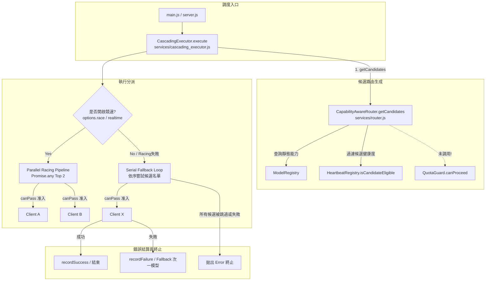
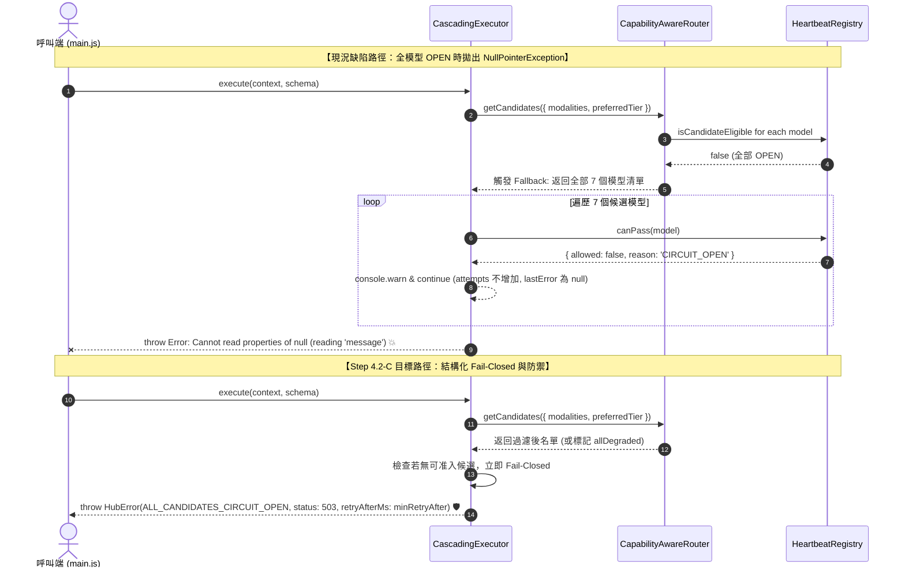

# P0-B Step 4.2-C — Router Cascading Integration 架構鑑識審計報告 (Architecture Forensic Audit)

> **階段代號**：P0-B Step 4.2-C  
> **鑑識標的**：級聯路由整合、Fail-Closed 與受控降級（Cascading Routing Integration & Fail-Closed / Fallback Policies）  
> **審查原則**：唯讀鑑識（Read-Only）、零程式碼修改、禁止擅自自由發揮、依真實程式碼行號取證  
> **作者/審計**：`etrnya`  
> **審查狀態**：唯讀架構鑑識完成，呈報架構裁決（待批准後方得進入實作）  

---

## 目錄
1. [現有級聯路由呼叫全貌與狀態流動](#1-現有級聯路由呼叫全貌與狀態流動)
2. [五大關鍵整合斷層鑑識（含程式碼確鑿證據）](#2-五大關鍵整合斷層鑑識含程式碼確鑿證據)
3. [時序分析與呼叫鏈斷層模型 (Sequence Analysis)](#3-時序分析與呼叫鏈斷層模型-sequence-analysis)
4. [Step 4.2-C 建議修改方案與防護設計](#4-step-42-c-建議修改方案與防護設計)
5. [規劃確定性離線測試規格 (Deterministic Test Suite Plan)](#5-規劃確定性離線測試規格-deterministic-test-suite-plan)
6. [架構約束與能力邊界自我審查](#6-架構約束與能力邊界自我審查)

---

## 1. 現有級聯路由呼叫全貌與狀態流動

在完成 Step 4.2-B-2 的三態健康狀態機與雙層 Token 閉環後，系統的核心狀態機已具備 `CLOSED`、`OPEN`、`HALF-OPEN`、世代防護與中性釋放能力。

然而，當我們將目光從「狀態機本身」放大到「整條端到端級聯路由（Cascading Routing Lifecycle）」時，呼叫關係如下：



---

## 2. 五大關鍵整合斷層鑑識（含程式碼確鑿證據）

經深入逐行審計 `services/router.js`、`services/cascading_executor.js`、`main.js` 與 `server.js`，發現級聯調度層存在以下五大深層整合問題：

### 斷層一：全模型熔斷時引發 JavaScript Null Pointer 崩潰 (Critical)
* **程式碼位置**：[`services/cascading_executor.js:284-290, 525`](file:///c:/Users/etrny/.gemini/antigravity/scratch/model-hub-agent/services/cascading_executor.js#L284-L290)
* **現有程式碼**：
  ```javascript
  // services/cascading_executor.js L285-289
  for (const capability of candidates) {
    const admission = heartbeatRegistry.canPass(capability.provider, capability.model_id);
    if (!admission.allowed) {
      console.warn(`[CascadingExecutor] 🛑 Admission rejected for ${capability.model_id} (${capability.provider}): ${admission.reason || 'Circuit Open'}. Cascading to next candidate.`);
      continue;
    }
    // ...
  }
  
  // services/cascading_executor.js L525
  throw new Error(`[CascadingExecutor] All ${attempts} candidates failed. Last error: ${lastError.message}`);
  ```
* **架構缺陷分析**：
  1. 當所有候選模型均處於 `OPEN` 熔斷狀態（例如上游 Provider 突發性故障或網絡中斷），`router.getCandidates()` 在所有模型均不可用時觸發 L125-128 Fallback，返回完整模型清單。
  2. 進入 `cascading_executor.js` 迴圈後，每一個模型在呼叫 `heartbeatRegistry.canPass()` 時均返回 `allowed: false`，因此全部觸發 `continue` 跳過。
  3. 迴圈結束時，變數 `attempts === 0`，且 `lastError === null`。
  4. 執行到 L525：`lastError.message` 瞬間引發原生執行時期例外：
     `TypeError: Cannot read properties of null (reading 'message')`！
  5. **影響**：系統非但沒有實現優雅的「Fail-Closed」，反而噴出底層 Null Pointer 崩潰，掩蓋了真實的熔斷原因。

---

### 斷層二：Router.route() 與 Router.getCandidates() 的 Quota 檢查分裂 (Inconsistency)
* **程式碼位置**：[`services/router.js:66-72 vs 114-122`](file:///c:/Users/etrny/.gemini/antigravity/scratch/model-hub-agent/services/router.js#L66-L72)
* **現有程式碼**：
  ```javascript
  // router.js:66-72 (route 方法)
  candidates = candidates.filter(m => {
    const quotaOk = quotaGuard.canProceed(m.provider, m.limits);
    const isEligible = typeof heartbeatRegistry.isCandidateEligible === 'function'
      ? heartbeatRegistry.isCandidateEligible(m.provider, m.model_id)
      : heartbeatRegistry.isHealthy(m.provider, m.model_id);
    return quotaOk && isEligible;
  });

  // router.js:114-122 (getCandidates 方法)
  let candidates = modelRegistry.getModelsByCapability(modalities)
    .filter(m => m.context_window >= minContext)
    .filter(m => {
      if (typeof heartbeatRegistry.isCandidateEligible === 'function') {
        return heartbeatRegistry.isCandidateEligible(m.provider, m.model_id);
      }
      return heartbeatRegistry.isHealthy(m.provider, m.model_id);
    });
  ```
* **架構缺陷分析**：
  1. `route()` 會檢查 `quotaGuard.canProceed()`，但實際驅動整個系統運行的 `CascadingExecutor` 呼叫的是 `getCandidates()`。
  2. `getCandidates()` **完全遺漏了 QuotaGuard 的配額檢查**！
  3. 當某個 Provider 的本機 RPM/TPM 配額已滿時，`getCandidates()` 仍會將其作為第一順位派發給 `CascadingExecutor`，直到打到 API 回傳 429 或被內部 QuotaGuard 攔截才被迫串行重試，徒增請求延遲。

---

### 斷層三：Parallel Racing（並行競速）孤兒探針懸掛問題 (Probe Leak)
* **程式碼位置**：[`services/cascading_executor.js:205-278`](file:///c:/Users/etrny/.gemini/antigravity/scratch/model-hub-agent/services/cascading_executor.js#L205-L278)
* **現有程式碼**：
  ```javascript
  const winner = await Promise.any([
    runCandidate(candidates[0]),
    runCandidate(candidates[1])
  ]);
  ```
* **架構缺陷分析**：
  1. 競速時，`runCandidate(candidates[0])` 與 `runCandidate(candidates[1])` 同時呼叫 `canPass()` 進行探針准入。
  2. 假設 `candidates[0]` 與 `candidates[1]` 恰巧有節點處於 `HALF-OPEN`，則各自簽發了 Canary Token。
  3. 當 `candidates[0]` 率先完成並由 `Promise.any` 返回勝出時，`candidates[1]` 的異步 Promise 成為在途的「孤兒請求 (Orphan Request)」。
  4. 如果 `candidates[1]` 在背景中稍後完成或拋錯，雖然其底層 `BaseClient` 會結算，但若發生中止或未完成，該探針將懸掛，直到 15 秒被動 Deadline/Timer 到期。在競速架構下，應具備對敗者探針的主動協同取消或中性釋放通知。

---

### 斷層四：級聯執行缺乏全域任務時間預算 (Global Task Timeout Budget)
* **程式碼位置**：[`services/cascading_executor.js:281-523`](file:///c:/Users/etrny/.gemini/antigravity/scratch/model-hub-agent/services/cascading_executor.js#L281-L523)
* **架構缺陷分析**：
  1. `model-hub-agent` 目前配置有 7 個候選模型。
  2. 每個模型由 `BaseClient` 原地重試最多 3 次（含指數退避），加上網絡逾時（15s ~ 30s）。
  3. 若遭遇區域性網絡阻斷，單一模型失敗可能耗費 10~20 秒，7 個模型累加將造成單一 Task 掛起超過 1~2 分鐘！
  4. 雖然系統有 Token 預算與費用預算熔斷 (`BudgetGuard`)，但**完全缺乏全域任務耗時預算（Task Timeout Budget）**。當串行級聯累積耗時超過門檻時，應主動截斷並觸發快速 Fail-Closed。

---

### 斷層五：級聯失敗時拋棄了 HubError 的結構化語意 (Taxonomy Erasure)
* **程式碼位置**：[`services/cascading_executor.js:525`](file:///c:/Users/etrny/.gemini/antigravity/scratch/model-hub-agent/services/cascading_executor.js#L525)
* **現有程式碼**：
  ```javascript
  throw new Error(`[CascadingExecutor] All ${attempts} candidates failed. Last error: ${lastError.message}`);
  ```
* **架構缺陷分析**：
  1. 前面的 Step 4.2-A 精心建立了結構化的 `HubError`（包含 `type`、`statusCode`、`faultScope`、`retryAfterMs`、`isTransient`）。
  2. 但在 `CascadingExecutor` 的終點，卻用普通的 `new Error(...)` 將其扁平化為單一字串，抹除了所有結構化欄位。
  3. 調用方（如 `main.js` 或外部 API `server.js`）無法從回傳錯誤中獲知：到底是因為「全部熔斷（ALL_CIRCUIT_OPEN）」、「驗證錯誤（VERIFICATION_FAILED）」、「配額耗盡（QUOTA_EXCEEDED）」還是「預算超限（BUDGET_EXCEEDED）」，被迫使用模糊的字串 Regex 去判斷錯誤類型。

---

## 3. 時序分析與呼叫鏈斷層模型 (Sequence Analysis)

下圖展示「全部模型熔斷」時，現有系統的異常軌跡與修復後的預期軌跡對比：



---

## 4. Step 4.2-C 建議修改方案與防護設計

遵守「**不新增 Manager、不重構既有狀態機、不修改 GlobalState**」之鐵律，建議採取以下針對性修補：

### 修正 1：修正 `CascadingExecutor` 的終端拋錯與 Fail-Closed 防線
- 在遍歷候選模型之前，若候選模型全數未通過准入檢查，或 `attempts === 0` 且 `lastError === null`：
  - 統計各 OPEN 節點的最小剩餘冷卻時間 `minRetryAfterMs`。
  - 封裝標準結構化 `HubError`（類型：`HUB_ALL_CANDIDATES_CIRCUIT_OPEN`，狀態碼：503，包含 `retryAfterMs`）。
  - 杜絕 `lastError.message` 的 Null Pointer 異常。

### 修正 2：對齊 `Router.getCandidates()` 的配額與健康雙重過濾
- 在 `Router.getCandidates()` 內補齊 `quotaGuard.canProceed(m.provider, m.limits)`，使其與 `Router.route()` 保持 100% 契約一致。
- 當所有模型均不 eligible 時，提供清晰的標記或空清單，避免回傳假候選造成後續盲目試探。

### 修正 3：引入全域任務時間預算門禁 (`taskTimeoutBudget`)
- 在 `CascadingExecutor` 讀取 `process.env.MAX_TASK_TIMEOUT_MS || 45000`（預設 45 秒）。
- 每次級聯嘗試前檢查 `Date.now() - taskStartTime`，一旦超時立即中止並拋出 `HUB_TASK_TIMEOUT_EXCEEDED`，防止串行級聯無限拖延。

### 修正 4：保留並傳遞結構化 `HubError`
- 當最後一個候選模型失敗時，直接將該候選模型拋出的 `HubError`（或以該錯誤為 cause）拋出，保留其原始 `type`、`statusCode` 與 `faultScope`，不被純字串抹除。

---

## 5. 規劃確定性離線測試規格 (Deterministic Test Suite Plan)

為驗證 Step 4.2-C 整合防線，建議在既有測試框架中擴充（或新增專屬整合測試 `tests/test_router_cascading_integration.js`），完全使用 Virtual Mock，無外部 API：

| 測試編號 | 測試名稱 | 驗證重點與斷言標準 |
| :---: | :--- | :--- |
| **Test C-1** | 全模型 OPEN 時優雅 Fail-Closed | 當所有 Provider/Model 均處於 OPEN 時，`execute()` 拋出 `HUB_ALL_CANDIDATES_CIRCUIT_OPEN`，**絕不**拋出 `TypeError: Cannot read properties of null`。 |
| **Test C-2** | Fail-Closed 攜帶精確最小 Retry-After | 拋出的結構化錯誤中，`retryAfterMs` 必須精準等於所有 OPEN 節點中最快結束冷卻的時間戳記。 |
| **Test C-3** | getCandidates 與 QuotaGuard 一致性 | 當某模型 Provider 配額耗盡時，`getCandidates()` 能正確排除該候選，不浪費串行呼叫。 |
| **Test C-4** | 全域任務超時 (Task Timeout Budget) 截斷 | 模擬各模型延遲，當累積耗時達到 45 秒預算時，第三個模型不再執行，直接返回超時錯誤。 |
| **Test C-5** | 終端錯誤保留 HubError 原始屬性 | 級聯完全失敗時，拋出的錯誤保留最後一個失敗模型的 `statusCode` 與 `faultScope`。 |

---

## 6. 架構約束與能力邊界自我審查

| 檢驗原則 | 遵循情況 | 審查說明 |
| :--- | :---: | :--- |
| **1. 不重構 heartbeat_registry.js** | ✅ 遵循 | 狀態機已凍結，Step 4.2-C 僅調用既有 `canPass()`、`isCandidateEligible()`，不修改狀態機內部結構。 |
| **2. 不新增 Manager / 抽象層** | ✅ 遵循 | 邏輯收斂於既有的 `services/router.js` 與 `services/cascading_executor.js`，不新增任何外部管理類別。 |
| **3. 不重啟 GlobalState 設計** | ✅ 遵循 | 完全不觸碰 `shared/global_state.js`。 |
| **4. 保留 npm test 確定性** | ✅ 遵循 | 所有測試計畫均基於 Virtual Clock 與注入式 Mock，0 外部 API 依賴。 |
| **5. 唯讀鑑識先行** | ✅ 遵循 | 本次動作僅產生本鑑識報告，**未修改任何業務代碼與測試代碼**，停止等待用戶審查。 |

---

> [!IMPORTANT]
> **鑑識完畢停止作業聲明**：  
> 本鑑識報告已詳盡列出五大整合斷層、重現路徑、時序圖、以及最小修復方案與測試計畫。  
> 依循紀律，**在此立即停止作業，等待架構審查裁決，絕不逕自修改代碼**。
