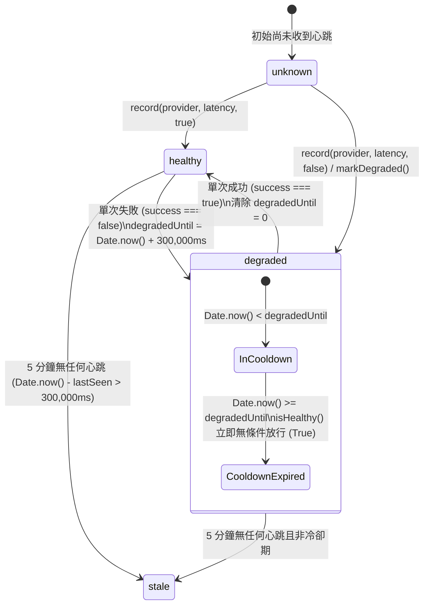

# Model Hub Agent: Router Health 三態健康狀態機架構鑑識與設計方案
> **階段代號**：P0-B Step 4.2-B-1  
> **審查維度**：Heartbeat Registry 唯讀架構鑑識、故障隔離粒度、三態狀態機（CLOSED / OPEN / HALF-OPEN）與 Canary Probe 併發控制  
> **作者/審計**：`etrnya`  
> **狀態**：唯讀架構鑑識完成，待審查批准（尚未修改任何程式碼）

---

## 目錄
1. [現有架構盤點與狀態流動鑑識](#1-現有架構盤點與狀態流動鑑識)
2. [現有呼叫關係與關鍵路徑盤點](#2-現有呼叫關係與關鍵路徑盤點)
3. [四層故障隔離粒度設計 (Fault Scope Matrix)](#3-四層故障隔離粒度設計-fault-scope-matrix)
4. [三態健康狀態機規格 (CLOSED / OPEN / HALF-OPEN)](#4-三態健康狀態機規格-closed--open--half-open)
5. [Canary Probe 併發控制與 Admission Control 設計](#5-canary-probe-併發控制與-admission-control-設計)
6. [Retry-After 與 BaseClient 整合策略](#6-retry-after-與-baseclient-整合策略)
7. [向下相容策略與 API 演化規範](#7-向下相容策略與-api-演化規範)
8. [最小修改檔案清單 (Step 4.2-B-2 實作預告)](#8-最小修改檔案清單-step-42-b-2-實作預告)
9. [15 組確定性離線測試規格 (Deterministic Test Suite)](#9-15-組確定性離線測試規格-deterministic-test-suite)
10. [未解決風險、邊界條件與設計取捨](#10-未解決風險邊界條件與設計取捨)

---

## 1. 現有架構盤點與狀態流動鑑識

### 1.1 現有 `HeartbeatRegistry` 實作全貌
現有 [`registry/heartbeat_registry.js`](file:///c:/Users/etrny/.gemini/antigravity/scratch/model-hub-agent/registry/heartbeat_registry.js) 實作行數共 105 行，是一個單例物件（`module.exports = new HeartbeatRegistry()`），內部狀態依賴一個記憶體 `Map`：
```javascript
// registry/heartbeat_registry.js:7-10
constructor() {
  this.history = new Map(); // Map<provider, { latency: number[], lastStatus: string, lastSeen: number, degradedUntil: number }>
  this.MAX_HISTORY = 10;
}
```

其內部主要儲存資料結構：
| 欄位名稱 | 型別 | 初始值 / 預設值 | 語意說明 |
| :--- | :--- | :--- | :--- |
| `latency` | `number[]` | `[]` | 最近 10 次請求耗時（ms），超過 10 筆則先進先出（`shift()`） |
| `lastStatus` | `string` | `'unknown'` | 最後一次回報狀態：`'healthy'` 或 `'degraded'` |
| `lastSeen` | `number` | `0` | 最後一次收到 heartbeat 的時間戳記（`Date.now()`） |
| `degradedUntil` | `number` | `0` | 熔斷冷卻結束時間戳記，一旦故障直接硬編碼 `Date.now() + 300000` (5 分鐘) |

### 1.2 現有狀態流動圖 (State Flow Diagram)


### 1.3 現況架構的三大致命缺陷
1. **單次故障即全局降級 (Single-Strike Hard Degradation)**：
   - 只要任何單一請求回報 `success === false`，`stats.lastStatus` 立即變為 `'degraded'`，且 `degradedUntil` 強制被鎖定 300 秒（5 分鐘）。沒有連續失敗閥值（Failure Threshold），缺乏抗噪能力。
2. **缺乏 HALF-OPEN 緩衝，冷卻結束立即大門敞開 (Thundering Herd on Cooldown Expiry)**：
   - 在 [`registry/heartbeat_registry.js:52-54`](file:///c:/Users/etrny/.gemini/antigravity/scratch/model-hub-agent/registry/heartbeat_registry.js#L52-L54)：
     ```javascript
     if (stats.lastStatus === 'degraded' && Date.now() < (stats.degradedUntil || 0)) {
       return false;
     }
     return true;
     ```
   - 一旦 `Date.now() >= degradedUntil`，`isHealthy(provider)` 瞬間直接回傳 `true`。若此時有 100 個併發請求湧入，這 100 個請求會同時打向剛剛才從故障復甦的上游 Provider，引發嚴重的**驚群效應 (Thundering Herd)**，再度擊垮上游。
3. **無差別粗粒度綁定 (Provider-Only Granularity)**：
   - 儲存鍵值完全以 `provider` 字串（如 `'google'`, `'vertex-ai'`, `'nvidia-nim'`, `'deepseek'`）為 Key。
   - 若某特定模型 `deepseek-reasoner` 發生 503 或不存在（404），會連帶將整組 Provider（包括健康且正常的 `deepseek-chat`）全數鎖死降級 5 分鐘。

---

## 2. 現有呼叫關係與關鍵路徑盤點

經由全域程式碼鑑識（Grep & AST 追蹤），現有程式庫對 `HeartbeatRegistry` 的所有呼叫點如下：

```mermaid
graph TD
    subgraph Upstream Ingestion [狀態寫入端]
        BC[BaseClient._callModelApi<br/>infrastructure/clients/base_client.js] -->|L95: record(provider, latency, true)<br/>L140: record(provider, latency, false)<br/>L141: markDegraded(provider, msg)| HR[(HeartbeatRegistry)]
        CE[CascadingExecutor.execute<br/>services/cascading_executor.js] -->|L485: record(provider, 0, false)| HR
        SRV_SEED[server.js:49-51] -->|啟動時種子資料<br/>record(provider, ms, true)| HR
        SRV_API[server.js:207] -->|/api/models/override-status<br/>record(provider, 0, success)| HR
        TEST_ADV[tests/test_advanced_features.js] -->|L157: record()<br/>L161: record()| HR
    end

    subgraph Downstream Consumers [狀態讀取端]
        HR -->|L68: isHealthy(m.provider)<br/>L96: getAverageLatency()| R_ROUTE[Router.route<br/>services/router.js]
        HR -->|L129: getAverageLatency()<br/>⚠️ 遺漏 isHealthy() 檢查!| R_CAND[Router.getCandidates<br/>services/router.js]
        HR -->|L184: getAllStats()| SRV_STATUS[server.js:184 GET /api/status]
        HR -->|L88: getAllStats()| MAIN[main.js:88 終端儀表板]
        HR -->|L158, 162: getStatus()| TEST_ADV
    end
```

### 2.1 呼叫點明細清單

| 檔案路徑與行號 | 呼叫函式 | 傳入參數 | 呼叫情境與行為問題 |
| :--- | :--- | :--- | :--- |
| [`infrastructure/clients/base_client.js:95`](file:///c:/Users/etrny/.gemini/antigravity/scratch/model-hub-agent/infrastructure/clients/base_client.js#L95) | `record(provider, duration, true)` | `this.modelCapability.provider`, `duration`, `true` | API 呼叫成功且完成計時，記錄延遲並重設為 healthy。**缺少 modelId**。 |
| [`infrastructure/clients/base_client.js:140-141`](file:///c:/Users/etrny/.gemini/antigravity/scratch/model-hub-agent/infrastructure/clients/base_client.js#L140-L141) | `record(...)`<br/>`markDegraded(...)` | `this.modelCapability.provider`, `duration`, `false`<br/>`this.modelCapability.provider`, `error.message` | 暫時性錯誤（Transient Error）原地重試失敗後，直接將整個 Provider 標記 degraded。**導致同 Provider 其他模型連坐處分**。 |
| [`services/cascading_executor.js:485`](file:///c:/Users/etrny/.gemini/antigravity/scratch/model-hub-agent/services/cascading_executor.js#L485) | `record(provider, 0, false)` | `capability.provider`, `0`, `false` | Catch 區塊中重複回報失敗。與 BaseClient 重複回報，且 latency 傳 0 會破壞平均延遲統計。 |
| [`services/router.js:68`](file:///c:/Users/etrny/.gemini/antigravity/scratch/model-hub-agent/services/router.js#L68) | `isHealthy(provider)` | `m.provider` | `route()` 核心排程過濾器。僅檢查 Provider，未檢查 Model。 |
| [`services/router.js:96, 129`](file:///c:/Users/etrny/.gemini/antigravity/scratch/model-hub-agent/services/router.js#L96) | `getAverageLatency(provider)` | `a.provider`, `b.provider` | 候選排序權重（第三優先）。 |
| [`services/router.js:108-133`](file:///c:/Users/etrny/.gemini/antigravity/scratch/model-hub-agent/services/router.js#L108-L133) | **完全未呼叫 `isHealthy`** | 無 | **【Critical 架構漏洞】**：`getCandidates()` 提供給 `CascadingExecutor` 的候選清單完全未過濾健康狀態，故障 Provider 仍會被送入級聯序列中！ |
| [`server.js:49-51`](file:///c:/Users/etrny/.gemini/antigravity/scratch/model-hub-agent/server.js#L49-L51) | `record(...)` | `'deepseek'`, `1200`, `true` 等 | Server 啟動時預設假心跳，防止 UI 顯示空白。 |
| [`server.js:184`](file:///c:/Users/etrny/.gemini/antigravity/scratch/model-hub-agent/server.js#L184) | `getAllStats()` | 無 | 供前端 Web UI 呈現系統狀態。 |
| [`server.js:207`](file:///c:/Users/etrny/.gemini/antigravity/scratch/model-hub-agent/server.js#L207) | `record(...)` | `provider`, `0`, `success` | 管理員手動覆寫模型健康狀態。 |
| [`main.js:88`](file:///c:/Users/etrny/.gemini/antigravity/scratch/model-hub-agent/main.js#L88) | `getAllStats()` | 無 | CLI 執行完成後的終端 Table 觀測輸出。 |

---

## 3. 四層故障隔離粒度設計 (Fault Scope Matrix)

系統必須能夠明確回答：「**究竟是哪個對象壞掉了，應該隔離誰？**」  
禁止將所有錯誤一律簡化為 Provider 級別故障。

### 3.1 實體識別鍵（Target Key）階層結構
在記憶體狀態樹中，實體識別鍵採用命名空間格式：
1. **Provider 級別 Key**：`${provider}`（例如：`google`、`deepseek`、`nvidia-nim`）
2. **Model 級別 Key**：`${provider}:${model_id}`（例如：`google:gemini-1.5-pro`、`deepseek:deepseek-reasoner`）
3. **Credential 級別 Key**：`${provider}:cred:${credentialHash}`（例如：`google:cred:a1b2c3d4`）
4. **Account 級別 Key**：`${provider}:account:${accountId}`（例如：`vertex-ai:account:my-gcp-project-123`）

> **最小必要識別資訊原則**：  
> 目前本機環境中，Provider Client 主要透過環境變數取得單一憑證（例如 `GEMINI_API_KEY`、`DEEPSEEK_API_KEY`、`GCP_KEY_PATH`），專案內尚未存在多租戶金鑰池。  
> 因此在 4.2-B 階段：
> - **Model 級**：直接由 `modelCapability.model_id` 辨識。
> - **Provider 級**：由 `modelCapability.provider` 辨識。
> - **Credential 級**：若 Client 傳入 apiKey 或 token，以其前 6 碼與後 4 碼產生 Hash；若未提供，暫時收斂映射至該 Provider 的當前憑證。
> - **Account 級**：Vertex AI 可直接由 `projectId` 辨識；其餘 Provider 若無傳入 `accountId` 則預設歸屬為 `default-account`。

### 3.2 故障類型與隔離範圍對照表 (Fault Scope Matrix)

| 錯誤類型 (`HubError.type`) | HTTP 狀態碼 / 錯誤特徵 | 根因歸屬 (Root Cause) | 應隔離的範圍 (Scope) | 隔離 Key 範例 | 處分動作與狀態機影響 |
| :--- | :--- | :--- | :--- | :--- | :--- |
| `HUB_MODEL_NOT_FOUND` | 404 Model Not Found / "model not found" | 該 Model ID 不存在或已下線 | **Model** | `deepseek:deepseek-v1` | **該 Model 標記永久/長效 OPEN**（如 24 小時）；同 Provider 其他 Model 正常放行。 |
| `HUB_INVALID_REQUEST` | 400 Context Length Overflow | 輸入超過該模型的最大 Context Window | **無須健康隔離** (Request-specific) | N/A | **不改變任何健康狀態**。屬於客戶端單次輸入問題，不代表模型故障。 |
| `HUB_AUTH_ERROR` | 401 Unauthorized / Invalid API Key | API Key 無效、憑證過期或被撤銷 | **Credential / Provider** | `nvidia-nim:cred:nvapi-xyz` | **該 Credential 進入 OPEN**。因目前 1 Provider 僅對應 1 Key，等同暫停該 Provider 所有模型，並發出 Critical 告警。 |
| `HUB_PERMISSION_DENIED` | 403 Account Suspended / Billing Disabled | 帳號欠費、專案未啟用 API、地域禁止 | **Account / Provider** | `vertex-ai:account:proj-99` | **該 Account / Provider 進入 OPEN**。同 Provider 之其他合法帳號不應受限。 |
| `HUB_RATE_LIMIT` (Model Quota) | 429 "Model TPM/RPM exceeded" | 該模型之併發或頻寬達到上限 | **Model** | `google:gemini-1.5-pro` | **僅該 Model 進入 OPEN**；若有 `Retry-After`，以其秒數為冷卻時間。`gemini-1.5-flash` 仍正常提供服務。 |
| `HUB_RATE_LIMIT` (Account Quota) | 429 "Daily quota exceeded for project" | 整個帳號或 Tier 的總量耗盡 | **Account / Provider** | `google:account:default` | **該 Account 或整個 Provider 進入 OPEN**；直到配額重置時間。 |
---

## 3.3 故障判定層：Error Scope Resolver

為了避免「HTTP Status 直接等同於故障範圍」的簡化缺陷，在進入狀態機前，必須由 **Error Scope Resolver** 依據錯誤類型、HTTP 狀態碼、Provider 回傳之原始錯誤訊息及子錯誤碼，解析出明確的 `faultScope`：

```javascript
/**
 * Fault Scopes:
 * - 'MODEL'      : 單一模型故障（如特定模型 404, 410, 模型過載 503, 單一模型 RPM 限流）
 * - 'PROVIDER'   : 整個接入端故障（如 502 Bad Gateway, 504 Gateway Timeout, 域名解析失敗, TCP 連線中斷）
 * - 'CREDENTIAL' : 憑證/密鑰無效（如 401 Invalid API Key, Token Revoked）
 * - 'ACCOUNT'    : 帳號層級限制（如 403 欠費停權, 每日專案總配額耗盡）
 * - 'NONE'       : 用戶端單次輸入問題（如 400 Context Overflow, 語法錯誤），不觸發健康處分
 * - 'UNKNOWN'    : 無法精確分類的錯誤。採保守原則：計入 Model 暫時失敗，絕不直接熔斷整個 Provider
 */
```

### 3.4 故障類型與隔離範圍對照表 (Fault Scope Matrix - 審查修訂版)

| 錯誤類型 (`HubError.type`) | HTTP 狀態碼 / 錯誤特徵 | 解析範圍 (`faultScope`) | 隔離 Key 結構 | 處分動作與狀態機影響 |
| :--- | :--- | :--- | :--- | :--- |
| `HUB_MODEL_NOT_FOUND` | 404 Model Not Found / "model not found" | **MODEL** | `${provider}:${model_id}` | 標記為 **OPEN (permanent: true)**。不可自動探測恢復，僅允許人工設定或重啟解除。 |
| `HUB_INVALID_REQUEST` | 400 Context Length Overflow / JSON Schema 格式錯 | **NONE** | N/A | **健康狀態機不處分**（不累加失敗計數，不改變狀態）。 |
| `HUB_AUTH_ERROR` | 401 Unauthorized / Invalid API Key | **CREDENTIAL** | `${provider}:cred:${hash}` | 標記為 **OPEN (permanent: true)**。發出 Critical 告警；目前環境因 1 Provider 1 Key，暫停該 Provider 所有請求。 |
| `HUB_PERMISSION_DENIED` | 403 Account Suspended / Billing Disabled | **ACCOUNT** | `${provider}:account:${id}` | 標記為 **OPEN**（不自動探測，直到收到帳號配額重設或手動覆寫）。 |
| `HUB_RATE_LIMIT` (Model RPM) | 429 "Model RPM/TPM limit exceeded" | **MODEL** | `${provider}:${model_id}` | 標記該 Model 為 **OPEN**；若有 `Retry-After`，以其為 `notBefore`。`flash` 模型正常服務。 |
| `HUB_RATE_LIMIT` (Project Quota) | 429 "Daily project quota exceeded" | **ACCOUNT** | `${provider}:account:${id}` | 標記該 Account / Provider 為 **OPEN**；依配額重設時間設定 `notBefore`。 |
| `HUB_PROVIDER_SERVER_ERROR` (503 Engine) | 503 "Model engine overloaded" | **MODEL** | `${provider}:${model_id}` | 標記該 Model 為 **OPEN**（冷卻 30s）；同 Provider 之其他模型正常服務。 |
| `HUB_PROVIDER_SERVER_ERROR` (502/504 Gateway) | 502 Bad Gateway, 504 Gateway Timeout | **PROVIDER** | `${provider}` | 標記整個 Provider 為 **OPEN**（冷卻 60s）；該 Provider 底下所有模型一併暫停。 |
| `HUB_NETWORK_ERROR` | `ECONNREFUSED`, `ENOTFOUND` (DNS 失敗) | **PROVIDER** | `${provider}` | 標記整個 Provider 為 **OPEN**（冷卻 30s）。 |
| `HUB_TIMEOUT_ERROR` | Transport Socket Timeout (客戶端逾時) | **MODEL (累加)** | `${provider}:${model_id}` | 單次不立即 OPEN，計入該 Model 之連續失敗計數器；連續 3 次逾時才進入 OPEN。 |
| `HUB_UNKNOWN_ERROR` | 無 HTTP status 或無法分類之未知例外 | **UNKNOWN -> MODEL** | `${provider}:${model_id}` | **保守原則**：僅視為該 Model 的 1 次暫時失敗，嚴禁直接隔離整個 Provider。 |

---

## 4. 三態健康狀態機規格 (CLOSED / OPEN / HALF-OPEN)

### 4.1 狀態定義與永久故障標記
```
+-----------------------------------------------------------------------------------+
|  [CLOSED]    : 正常狀態。健康度良好，允許所有流量通過。統計連續暫時失敗次數。       |
|  [OPEN]      : 熔斷狀態。                                                         |
|                - 一般 OPEN: 在 notBefore / cooldownUntil 期間拒絕一般請求。         |
|                - permanent: true (如 404/401): 永久關閉，不自動進入 HALF-OPEN。      |
|  [HALF-OPEN] : 試探狀態。冷卻期滿後，僅允許發放唯一代幣 (Canary Token) 進行單一探測。|
+-----------------------------------------------------------------------------------+
```

### 4.2 狀態轉換矩陣 (State Transition Table - 審查修訂版)

| 目前狀態 | 觸發事件 / 條件 | 目標狀態 | 附加動作與狀態變更 |
| :--- | :--- | :--- | :--- |
| **CLOSED** | 收到成功心跳 (`success === true`) | **CLOSED** | 重設 `consecutiveFailures = 0`；更新延遲指標。 |
| **CLOSED** | 收到暫時失敗且 `faultScope !== 'NONE'`，次數未達 `FAILURE_THRESHOLD (3)` | **CLOSED** | `consecutiveFailures++`；保持放行。 |
| **CLOSED** | 收到暫時失敗且 `consecutiveFailures >= 3` | **OPEN** | `state = 'OPEN', permanent = false`；計算 `cooldownUntil = now + cooldownMs`。 |
| **CLOSED** | 收到永久性致命錯誤 (`404 Model Not Found`, `401 Auth Error`) | **OPEN** | `state = 'OPEN', permanent = true`；記錄 `openReason`；**不排定自動恢復冷卻**。 |
| **CLOSED** | 收到上游限流或 `retryAfterExceeded` | **OPEN** | `state = 'OPEN', permanent = false`；**精確保留原始 notBefore**（禁止縮短）。 |
| **OPEN** | 請求到達，且 `permanent === true` | **OPEN** | **拒絕准入 (Permanent Fault)**。不嘗試進入 HALF-OPEN，等待人工解鎖。 |
| **OPEN** | 請求到達，且 `now < notBefore` (或 `cooldownUntil`) | **OPEN** | **拒絕准入 (Circuit Open)**。回傳剩餘冷卻時間。 |
| **OPEN** | 請求到達，且 `permanent === false && now >= notBefore` | **HALF-OPEN** | `state = 'HALF-OPEN'`；初始化探針管理結構，準備發放唯一 Token。 |
| **HALF-OPEN**| 第一個請求呼叫 `canPass()` | **HALF-OPEN** | 發放 `probeToken` (具唯一 Nonce 與世代識別)，標記 `probeDeadline = now + 15000`。 |
| **HALF-OPEN**| 探針執行中，併發請求呼叫 `canPass()` | **HALF-OPEN** | **拒絕准入 (`CANARY_PROBE_IN_FLIGHT`)**。立即回傳不可用，引導轉向 Fallback。 |
| **HALF-OPEN**| 探針攜帶**當前有效 Token** 回報成功 | **CLOSED** | `state = 'CLOSED'`；清空探針 Token；重設失敗計數與初始冷卻時間。 |
| **HALF-OPEN**| 探針攜帶**當前有效 Token** 回報失敗 | **OPEN** | `state = 'OPEN'`；冷卻時間加倍退避；銷毀當前 Token。 |
| **HALF-OPEN**| **過期舊 Token** 延遲回報成功或失敗 | 不變 | **嚴格忽略 (Drop Stale Probe Report)**。舊 Token 不得覆寫新狀態。 |
| **HALF-OPEN**| 探針懸掛超過 15 秒 (`now >= probeDeadline` 或 Timer 觸發) | **OPEN** | **雙層 Watchdog 介入**：主動 Timer 或被動查詢強制回收 Token，判定超時並退回 OPEN。 |

---

## 5. Canary Probe 世代防護、雙層 Watchdog 與准入分離

### 5.1 探針結構與世代 Token (Generational Token)
為徹底杜絕「過期探針延遲回報，錯誤將新狀態改回 CLOSED」的 Race Condition，探針結構定義如下：
```javascript
{
  probeActive: true,
  probeToken: `probe_${Date.now()}_${Math.random().toString(36).substring(2, 9)}`,
  probeStartedAt: 1700000000000,
  probeDeadline: 1700000015000 // now + 15000ms
}
```
**回報校驗原則**：
當上層呼叫 `recordSuccess(token)` 或 `recordFailure(token)` 時：
- 若傳入的 `token !== this.probeToken`，**一律直接捨棄 (Drop)**，並記錄警告日誌。
- 只有與目前記憶體中完全相符的有效 Token 才有權利推動狀態轉移。

### 5.2 雙層 Watchdog 防護：主動 Timer + 被動 Deadline 檢查
1. **主動防護 (Active Timer)**：
   - 發放 Token 時啟動 `setTimeout(..., 15000)`，若到期仍未完成，自動將 Token 標記失效並轉移至 OPEN。
2. **被動防護 (Passive Deadline Check)**：
   - 在每次 `canPass()`、`isHealthy()` 或 `getStatus()` 被呼叫時，主動檢查：
     ```javascript
     if (this.state === 'HALF-OPEN' && this.probeActive && now >= this.probeDeadline) {
       this._tripToOpen(now, { isExponential: true, reason: 'WATCHDOG_DEADLINE_EXPIRED' });
     }
     ```
   - 此設計保證：即使 Node.js 事件循環因大量運算阻塞導致 Timer 延遲觸發，下一個進入的請求也能依據被動 Deadline 即刻發現超時並回收探針。

### 5.3 職責分離：`isHealthy()` 唯讀查詢 vs `canPass()` 請求准入
- **`isHealthy(provider, modelId)`**：
  - **純唯讀狀態查詢**。用於儀表板、監控、日誌記錄，絕不發放 Token，亦不產生狀態轉移副作用。
  - 當處於 `HALF-OPEN` 且有探針在進行中時，回傳 `false`（表示一般流量不可用）。
- **`canPass(provider, modelId, requestContext)`**：
  - **請求准入控制 (Admission Gate)**。專門供 `Router` 與執行器調用。
  - 當處於 `HALF-OPEN` 且尚未有活躍探針時，此呼叫會**原子地**扣除探測配額，發放唯一 `probeToken`，並啟動探針生命週期。

---

## 6. Retry-After 長時間限流政策 (NotBefore 絕對時間保證)

### 6.1 嚴禁縮短 Provider 要求的等待時間
- 針對使用者提出的架構警告：「若 Provider 回傳 `Retry-After: 3600`，不可為了系統預設而將其截斷為 5 分鐘，否則 5 分鐘後重新探針只會再度撞上限流」。
- **修正後的 NotBefore 策略**：
  1. **保留原始 `notBefore`**：計算 `notBefore = Date.now() + (retryAfterSeconds * 1000)`。
  2. **在 `notBefore` 到達之前，狀態機嚴格保持 OPEN，絕對禁止進入 HALF-OPEN**。
  3. **拒絕截短**：若上游要求 1 小時，系統就記錄 1 小時的 `notBefore`；期間該 Model/Provider 100% 拒絕准入，排程器全面轉向其他備援候選（Fallback）。
  4. **Retry-After = 0 政策**：原地重試成功則健康狀態維持 CLOSED；但不得僅因 `Retry-After: 0` 就清空原有的故障計數器，唯有實際請求成功回報時方可重設。

---

## 7. 向下相容策略與 API 演化規範

保持既有 API 簽名不變，透過參數多型支援新特性：
1. `record(target, latency, success, options = {})`
   - `options` 支援 `{ token, faultScope, error, retryAfterMs, permanent }`。
   - 舊呼叫 `record('deepseek', 100, true)` 自動轉譯為 Provider 級別操作。
2. `isHealthy(provider, modelId = null)`：純查詢，向後相容。
3. `canPass(provider, modelId = null, options = {})`：准入專用，支援 Canary Probe 發券。
4. `getStatus(provider, modelId = null)`：若為 `permanent: true`，回傳 `'degraded'` (向後相容) 或在詳細結構中標記 `'OPEN_PERMANENT'`。

---

## 8. 最小修改檔案清單 (Step 4.2-B-2 實作預告)

| 檔案路徑 | 預計修改範圍 | 變更性質與安全防護 |
| :--- | :--- | :--- |
| [`registry/heartbeat_registry.js`](file:///c:/Users/etrny/.gemini/antigravity/scratch/model-hub-agent/registry/heartbeat_registry.js) | **核心修改**：原地上線 `CircuitBreakerNode`、支援 4 層 faultScope、世代 Token、雙層 Watchdog、notBefore 政策、`isHealthy` 與 `canPass` 分離。 | 原地升級，保留所有既有介面。 |
| [`infrastructure/adapters/error_mapper.js`](file:///c:/Users/etrny/.gemini/antigravity/scratch/model-hub-agent/infrastructure/adapters/error_mapper.js) | 擴充 `toHubError` 與分類邏輯，輸出明確的 `faultScope: 'MODEL' \| 'PROVIDER' \| 'CREDENTIAL' \| 'ACCOUNT' \| 'NONE' \| 'UNKNOWN'`。 | 讓錯誤具備標準故障隔離範圍。 |
| [`services/router.js`](file:///c:/Users/etrny/.gemini/antigravity/scratch/model-hub-agent/services/router.js) | 1. `route()` 使用 `heartbeatRegistry.canPass(m.provider, m.model_id)`。<br/>2. `getCandidates()` 加入 `isHealthy(m.provider, m.model_id)` 過濾。 | 修補候選清單繞過健康的漏洞。 |
| [`services/cascading_executor.js`](file:///c:/Users/etrny/.gemini/antigravity/scratch/model-hub-agent/services/cascading_executor.js) | Line 485: 將失敗回報改為傳入結構化資訊 `record({ provider, modelId }, 0, false, { error })`。 | 確保級聯錯誤精確記錄至 Model 節點。 |
| [`infrastructure/clients/base_client.js`](file:///c:/Users/etrny/.gemini/antigravity/scratch/model-hub-agent/infrastructure/clients/base_client.js) | 呼叫 `record` 時帶入 `modelCapability.model_id` 與 Canary Token。 | 串聯 Canary Probe 完成/失敗閉環。 |

---

## 9. 20 組確定性離線測試規格 (Deterministic Test Suite)

在 `tests/test_router_health_state_machine.js` 中實現，**完全使用 Virtual Mock Clock，零真實延遲**：

1. **Test 1: CLOSED 正常放行**：驗證初始狀態放行。
2. **Test 2: CLOSED 容錯閥值未達標不熔斷**：連續 1~2 次暫時失敗不進入 OPEN。
3. **Test 3: 連續失敗達標進入 OPEN**：第 3 次暫時失敗進入 OPEN。
4. **Test 4: OPEN 冷卻期內嚴格拒絕一般請求**：未滿冷卻時間回傳 `allowed: false`。
5. **Test 5: OPEN 冷卻期滿自動進入 HALF-OPEN**：冷卻結束下一個請求進入 HALF-OPEN。
6. **Test 6: HALF-OPEN 僅發放單一 Canary Probe Token**：第一請求獲取 probeToken。
7. **Test 7: Canary Probe 執行中併發請求全數被拒**：併發請求拒絕並引導 Fallback。
8. **Test 8: Canary Probe 成功使狀態回歸 CLOSED**：有效 Token 成功回報使狀態恢復。
9. **Test 9: Canary Probe 失敗使狀態打回 OPEN 且冷卻加倍**：有效 Token 失敗觸發指數退避。
10. **Test 10: Canary Probe 懸掛主動超時保護**：Timer 到期回收 Token 並打回 OPEN。
11. **Test 11: Model 級故障隔離不影響同 Provider 的其他 Model**：`flash` 不受 `pro` 故障影響。
12. **Test 12: Provider 級故障全體連鎖隔離**：502/網絡錯誤隔離整個 Provider。
13. **Test 13: 401 憑證錯誤立即長效隔離**：不累加 3 次，立即 OPEN。
14. **Test 14: Retry-After 正常範圍對齊冷卻**：依上游給予秒數設定冷卻。
15. **Test 15: 舊版 API 完全向下相容性**：`record(p, l, s)`、`isHealthy(p)` 正常運作。
16. **Test 16: 舊 Probe Token 過期後回報成功，不得解除新 OPEN 狀態 (Stale Token Rejection)**：Probe A 超時後延遲回報，狀態不被竄改。
17. **Test 17: Watchdog Timer 未及時執行時，被動 Deadline 仍能回收過期 Probe (Passive Deadline Guard)**：事件循環阻塞下，查詢即刻檢測到過期並回收。
18. **Test 18: Retry-After 超過 5 分鐘時，不得提早進入 HALF-OPEN (No Silent Truncation)**：Provider 要求 1 小時，冷卻嚴格鎖定 1 小時，不截斷為 5 分鐘。
19. **Test 19: OPEN_PERMANENT 永久故障防護**：404 模型永不自動探測，直到人工作業解除。
20. **Test 20: Credential / Account 故障精確隔離不污染其他對象**：Account A 停權不影響 Account B。

---

## 10. 未解決風險、邊界條件與設計取捨

1. **單處理序記憶體狀態 vs 分散式部署**：單機 Agent OS 先行，資料結構保留純 JSON 序列化能力，未來可隨時介接 Redis。
2. **CascadingExecutor 的全域任務預算**：需在後續加入 `taskTimeoutBudget`，避免每個候選模型各自等待耗盡總時間。
3. **過度敏感的探針震盪**：5 分鐘內連續 2 次 OPEN 時，自動加倍初始冷卻時間。

