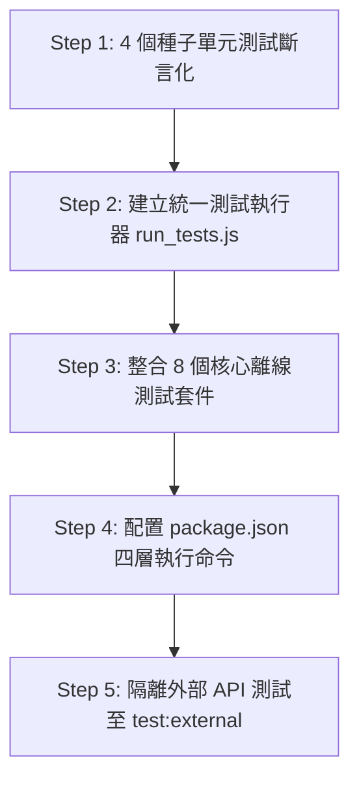

# Model Hub Agent 測試重構執行計畫書 (TEST_REFACTOR_PLAN.md)

> **計畫目標**：依據 `TEST_INVENTORY.md` 盤點結果，訂定循序漸進、不破壞現有業務代碼的 P0-B 測試重構實施藍圖。  
> **核心使命**：讓預設 `npm test` 在 0 外部 API 呼叫、0 外部網路依賴的前提下，於 2 秒內完成所有核心安全、狀態、壓縮、自癒與調度邏輯的確定性驗證。

---

## 🎯 一、 重構分期里程碑與路線圖



---

## 📅 二、 逐檔重構執行清單與預估工作量

### 第一階段：4 個核心離線測試的「去觀察化、斷言化」重構（預估 4 個工項）

| 優先序 | 標的檔案 | 目前缺陷 | 重構行動項目 | 斷言重點 | 預估工時 |
| :---: | :--- | :--- | :--- | :--- | :---: |
| **#1** | `tests/test_guardrail.js` | 僅 `console.log`，無 `assert`，永遠 exit 0 | 引入 `assert/strict`，包覆異步錯誤捕獲與非零退出 | (1) 惡意注入必須 `safe === false`<br>(2) DLP 遮蔽後的字串必須不含原始金鑰與 email | 20 mins |
| **#2** | `tests/test_silent_fix.js` | `catch` 吞掉錯誤，無 `assert` | 改用 `assert.deepStrictEqual` 比對自癒後 JSON | 5 種格式修復情境之產出必須 100% 吻合預期 Schema 物件 | 20 mins |
| **#3** | `tests/test_compression.js` | 僅列印壓縮率與欄位存在性 | 引入 `assert.ok` 與 `assert.strictEqual` | (1) Standard 下 `objective` 嚴格保留<br>(2) Hard 下除錯雜訊與 trace 100% 抹除 | 25 mins |
| **#4** | `tests/test_self_correction_flow.js` | 已有 Mock 但僅人眼看結果，無 exit code | 補齊流程斷言，驗證修正次數與 payload 結構 | (1) 首次違規觸發<br>(2) 二次修正攜帶 `_correction_feedback`<br>(3) 修正後成功回傳 | 30 mins |

---

### 第二階段：實作統一測試執行器 `tests/run_tests.js`（預估 1 個工項）

* **設計規格**：
  * **零第三方套件依賴**：基於 Node.js 內建 `child_process.fork` 或動態 `import/require`。
  * **參數解析**：支援 `--unit`、`--integration`、`--external`、`--all`。
  * **即時報告看板**：
    ```text
    ==================================================
    🧪 Antigravity Agent OS - Test Suite Runner
    Mode: [UNIT + INTEGRATION] (100% Offline)
    ==================================================
    [1/8] test_fail_closed.js ........... PASS (8/8 assertions)
    [2/8] test_guardrail.js ............. PASS (3/3 assertions)
    [3/8] test_silent_fix.js ............ PASS (5/5 assertions)
    [4/8] test_compression.js ........... PASS (4/4 assertions)
    [5/8] test_circuit_breaker.js ....... PASS (1/1 assertions)
    [6/8] test_self_correction_flow.js .. PASS (3/3 assertions)
    [7/8] test_advanced_features.js ..... PASS (4/4 assertions)
    [8/8] test_ecc_features.js .......... PASS (3/3 assertions)
    --------------------------------------------------
    Total: 8 suites, 31 assertions | 0 Failed
    Status: ALL PASSED (Duration: 1.24s)
    ==================================================
    ```
  * **非零 Exit Code 守護**：只要任一測試腳本拋錯或 assertion 失敗，執行器直接 `process.exit(1)`。

---

### 第三階段：`package.json` 腳本分流與門禁綁定

```json
{
  "scripts": {
    "test": "node tests/run_tests.js",
    "test:unit": "node tests/run_tests.js --unit",
    "test:integration": "node tests/run_tests.js --integration",
    "test:external": "node tests/run_tests.js --external",
    "test:all": "node tests/run_tests.js --all",
    "diagnose": "node tests/diagnose_keys.js",
    "benchmark": "node tests/benchmark_runner.js"
  }
}
```

---

## 🛡️ 三、 重構安全防線（Invariant Safeguards）

1. **不可降低斷言標準**：禁止為了追求「全綠燈」而使用寬鬆的 `assert.ok(result)`，必須比對精確屬性與值（如 `assert.strictEqual(result.safe, false)`）。
2. **禁止隱性網路穿透**：重構單元與整合測試時，若發現任何未被 mock 的客戶端試圖發起真實 HTTP 請求，該測試立即標記為失敗並阻斷。
3. **無損現有功能**：現有的 `diagnose_keys.js` 與外部真實測試腳本維持原樣，僅變更呼叫路徑，供手動端到端除錯使用。
